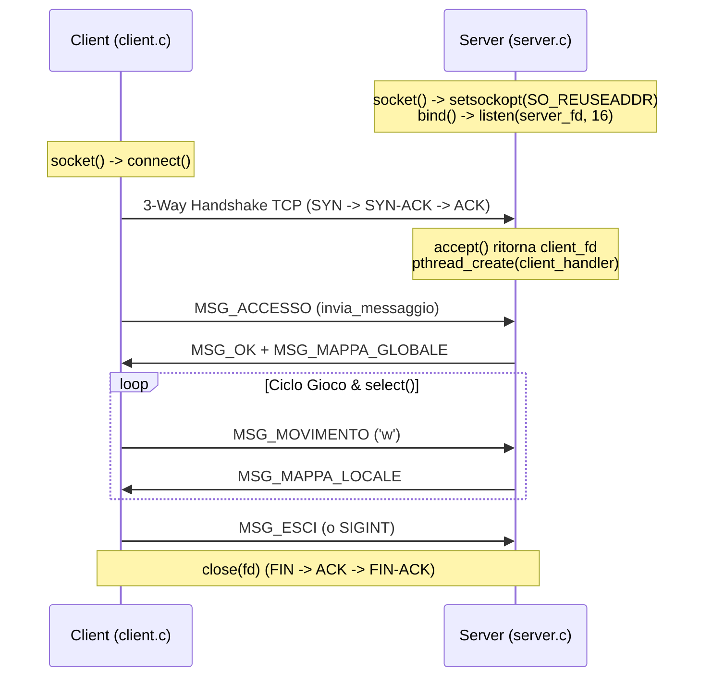

# Guida Completa allo Studio: Mappatura Progetto Labirinto $\longleftrightarrow$ Appunti LSO

> **Corso:** Laboratorio di Sistemi Operativi (8 CFU) — Università degli Studi di Napoli Federico II  
> **Docente:** Prof. Alberto Finzi  
> **Scopo del documento:** Collegare ogni singola riga di codice, chiamata di sistema e scelta architetturale del progetto [labirinto](file:///c:/Users/Paolo/Desktop/Universita/TerzoAnno/LSO/Progetto/labirinto) ai rispettivi capitoli teorici della [Guida_Completa_LSO.md](file:///c:/Users/Paolo/Desktop/Universita/TerzoAnno/LSO/Materiale/Appunti/Guida_Completa_LSO.md). Questo report funge da **manuale di studio completo** per la discussione del progetto e l'esame orale.

---

## 1. Matrice Sinottica di Corrispondenza (Dove e Cosa Studiare)

| Argomento Tecnico | File del Progetto | Riferimento Guida LSO | Riga esatta nella Guida | Concetti Chiave da Sapere all'Esame |
| :--- | :--- | :--- | :--- | :--- |
| **Toolchain & Compilazione** | [Makefile](file:///c:/Users/Paolo/Desktop/Universita/TerzoAnno/LSO/Progetto/labirinto/Makefile) | **Cap. 9** — Compilazione C e GCC | [riga 1226](file:///c:/Users/Paolo/Desktop/Universita/TerzoAnno/LSO/Materiale/Appunti/Guida_Completa_LSO.md#L1226) | `-Wall -Wextra`, flag `-pthread`, regole e target, pulizia `.PHONY`. |
| **I/O File a Basso Livello** | [server/log.c](file:///c:/Users/Paolo/Desktop/Universita/TerzoAnno/LSO/Progetto/labirinto/server/log.c#L11-L34) | **Cap. 10** — I/O di Basso Livello | [riga 1349](file:///c:/Users/Paolo/Desktop/Universita/TerzoAnno/LSO/Materiale/Appunti/Guida_Completa_LSO.md#L1349) | `open()` con flag `O_WRONLY\|O_CREAT\|O_APPEND`, permessi ottali `0644`, `write()`, `close()`. |
| **Gestione Segnali Asincroni** | [client/client.c](file:///c:/Users/Paolo/Desktop/Universita/TerzoAnno/LSO/Progetto/labirinto/client/client.c#L17-L21), [server/server.c](file:///c:/Users/Paolo/Desktop/Universita/TerzoAnno/LSO/Progetto/labirinto/server/server.c#L164-L165) | **Cap. 12** — Segnali & **Cap. 19** | [riga 2317](file:///c:/Users/Paolo/Desktop/Universita/TerzoAnno/LSO/Materiale/Appunti/Guida_Completa_LSO.md#L2317), [riga 4695](file:///c:/Users/Paolo/Desktop/Universita/TerzoAnno/LSO/Materiale/Appunti/Guida_Completa_LSO.md#L4695) | `signal(SIGPIPE, SIG_IGN)`, intercettazione `SIGINT` (Ctrl+C), gestione ripresa `EINTR`. |
| **Multithreading POSIX** | [server/server.c](file:///c:/Users/Paolo/Desktop/Universita/TerzoAnno/LSO/Progetto/labirinto/server/server.c#L48-L136) | **Cap. 14** — Thread e Concorrenza | [riga 2921](file:///c:/Users/Paolo/Desktop/Universita/TerzoAnno/LSO/Materiale/Appunti/Guida_Completa_LSO.md#L2921) | Modello 1:1 (LWP), `pthread_create()`, `pthread_detach()`, passaggio argomenti con `malloc()`. |
| **Sincronizzazione (Mutex)** | [server/game.c](file:///c:/Users/Paolo/Desktop/Universita/TerzoAnno/LSO/Progetto/labirinto/server/game.c#L96), [server/log.c](file:///c:/Users/Paolo/Desktop/Universita/TerzoAnno/LSO/Progetto/labirinto/server/log.c#L9) | **Cap. 15** — Sincronizzazione e Mutex | [riga 3322](file:///c:/Users/Paolo/Desktop/Universita/TerzoAnno/LSO/Materiale/Appunti/Guida_Completa_LSO.md#L3322) | Race conditions, sezioni critiche, `pthread_mutex_lock/unlock`, init statica vs dinamica. |
| **Socket TCP (Server & Client)** | [server/server.c](file:///c:/Users/Paolo/Desktop/Universita/TerzoAnno/LSO/Progetto/labirinto/server/server.c#L21-L45), [client/client.c](file:///c:/Users/Paolo/Desktop/Universita/TerzoAnno/LSO/Progetto/labirinto/client/client.c#L46-L70) | **Cap. 17** — Socket di Rete | [riga 3885](file:///c:/Users/Paolo/Desktop/Universita/TerzoAnno/LSO/Materiale/Appunti/Guida_Completa_LSO.md#L3885) | `socket()`, `bind()`, `listen()`, `accept()`, `connect()`, `SO_REUSEADDR`, `htons()`, `inet_pton()`. |
| **I/O di Rete Robusto (Framing)** | [common/protocol.c](file:///c:/Users/Paolo/Desktop/Universita/TerzoAnno/LSO/Progetto/labirinto/common/protocol.c#L6-L41) | **Sez. 17.6 & 17.14** — Short Read/Write | [riga 4142](file:///c:/Users/Paolo/Desktop/Universita/TerzoAnno/LSO/Materiale/Appunti/Guida_Completa_LSO.md#L4142), [riga 4434](file:///c:/Users/Paolo/Desktop/Universita/TerzoAnno/LSO/Materiale/Appunti/Guida_Completa_LSO.md#L4434) | Streaming orientato ai byte, pattern `send_all`/`recv_all`, rilevazione EOF su `read() == 0`. |
| **I/O Multiplexing (`select`)** | [client/client.c](file:///c:/Users/Paolo/Desktop/Universita/TerzoAnno/LSO/Progetto/labirinto/client/client.c#L106-L160) | **Cap. 18** — Multiplexing `select()` | [riga 4526](file:///c:/Users/Paolo/Desktop/Universita/TerzoAnno/LSO/Materiale/Appunti/Guida_Completa_LSO.md#L4526) | Pattern Master Set vs Working Set (`read_set = master_set`), `FD_ZERO`, `FD_SET`, `FD_ISSET`, `max_fd`. |
| **Bug-Hunting & Deadlock Evitato** | [server/game.c](file:///c:/Users/Paolo/Desktop/Universita/TerzoAnno/LSO/Progetto/labirinto/server/game.c#L377-L379) | **Cap. 25.1.3** — Deadlock Mutex/Socket | [riga 6099](file:///c:/Users/Paolo/Desktop/Universita/TerzoAnno/LSO/Materiale/Appunti/Guida_Completa_LSO.md#L6099) | Perché sbloccare il mutex **prima** di inviare dati su rete (`send`/`write`). |

---

## 2. Dettaglio Argomento per Argomento: Studio Teorico e Corrispettivo Pratico

---

### Modulo 1: Compilazione C, Toolchain e Makefile
* **File sorgente:** [Makefile](file:///c:/Users/Paolo/Desktop/Universita/TerzoAnno/LSO/Progetto/labirinto/Makefile)
* **Capitolo della Guida:** [Capitolo 9 — Compilazione C e GCC (riga 1226)](file:///c:/Users/Paolo/Desktop/Universita/TerzoAnno/LSO/Materiale/Appunti/Guida_Completa_LSO.md#L1226)

#### Cosa studiare nella Guida:
1. **Sezione 9.1 — Fasi della Compilazione** ([riga 1230](file:///c:/Users/Paolo/Desktop/Universita/TerzoAnno/LSO/Materiale/Appunti/Guida_Completa_LSO.md#L1230)): Preprocessing (`cpp`), Compilazione in Assembly (`gcc -S`), Assemblaggio (`as -c`), Linking (`ld`).
2. **Sezione 9.2 — Flag di compilazione raccomandati dal docente** ([riga 1260](file:///c:/Users/Paolo/Desktop/Universita/TerzoAnno/LSO/Materiale/Appunti/Guida_Completa_LSO.md#L1260)):
   * `-Wall -Wextra`: Abilita tutti gli avvisi diagnostici del compilatore.
   * `-g`: Include le informazioni di debug per `gdb` e `valgrind`.
   * `-pthread`: **Fondamentale.** Configura il preprocessore (definisce `_REENTRANT`) e collega la libreria dei thread POSIX `libpthread`.
   * `-Icommon`: Aggiunge la directory comune per gli include degli header (`protocol.h`).
3. **Target speciali:** `.PHONY: all clean` impedisce conflitti nel caso in cui esistano file denominati "clean" o "all" nella directory.

---

### Modulo 2: I/O di Basso Livello (File Descriptor e System Call)
* **File sorgente:** [server/log.c](file:///c:/Users/Paolo/Desktop/Universita/TerzoAnno/LSO/Progetto/labirinto/server/log.c), [server/log.h](file:///c:/Users/Paolo/Desktop/Universita/TerzoAnno/LSO/Progetto/labirinto/server/log.h)
* **Capitolo della Guida:** [Capitolo 10 — I/O di Basso Livello (System Call) (riga 1349)](file:///c:/Users/Paolo/Desktop/Universita/TerzoAnno/LSO/Materiale/Appunti/Guida_Completa_LSO.md#L1349)

```c
// Da server/log.c:
int log_open(const char *path) {
    log_fd = open(path, O_WRONLY | O_CREAT | O_APPEND, 0644);
    ...
}
```

#### Cosa studiare nella Guida:
1. **Differenza tra I/O Formattato (`<stdio.h>`) e I/O di Basso Livello POSIX (`<unistd.h>`, `<fcntl.h>`)** ([riga 1352](file:///c:/Users/Paolo/Desktop/Universita/TerzoAnno/LSO/Materiale/Appunti/Guida_Completa_LSO.md#L1352)):
   * `fopen`/`fprintf`/`fclose` usano i buffer nello spazio utente (`FILE*`).
   * `open`/`write`/`close` interagiscono direttamente con il Kernel tramite **file descriptor** interi (`int`).
2. **Flag di `open()`** ([riga 1374](file:///c:/Users/Paolo/Desktop/Universita/TerzoAnno/LSO/Materiale/Appunti/Guida_Completa_LSO.md#L1374)):
   * `O_WRONLY`: Apertura in sola scrittura.
   * `O_CREAT`: Crea il file se non esiste. Quando presente, il terzo parametro (`mode`) è obbligatorio.
   * `O_APPEND`: Posiziona il puntatore di scrittura alla fine del file a ogni singola `write`, garantendo che i messaggi di log successivi non sovrascrivano i precedenti.
3. **Maschera dei permessi ottali `0644`** ([riga 1385](file:///c:/Users/Paolo/Desktop/Universita/TerzoAnno/LSO/Materiale/Appunti/Guida_Completa_LSO.md#L1385)):
   * `0644` $\rightarrow$ Proprietario: lettura e scrittura (`rw-` = 6), Gruppo: sola lettura (`r--` = 4), Altri: sola lettura (`r--` = 4).

---

### Modulo 3: Segnali Asincroni (SIGPIPE ed EINTR)
* **File sorgente:** [server/server.c](file:///c:/Users/Paolo/Desktop/Universita/TerzoAnno/LSO/Progetto/labirinto/server/server.c#L164-L165), [client/client.c](file:///c:/Users/Paolo/Desktop/Universita/TerzoAnno/LSO/Progetto/labirinto/client/client.c#L17-L21)
* **Capitoli della Guida:** [Capitolo 12 — Segnali (riga 2317)](file:///c:/Users/Paolo/Desktop/Universita/TerzoAnno/LSO/Materiale/Appunti/Guida_Completa_LSO.md#L2317) e [Capitolo 19 — Segnali nelle Socket: SIGPIPE ed EINTR (riga 4695)](file:///c:/Users/Paolo/Desktop/Universita/TerzoAnno/LSO/Materiale/Appunti/Guida_Completa_LSO.md#L4695)

#### Cosa studiare nella Guida:
1. **Il Segnale `SIGPIPE` nelle connessioni TCP** ([riga 4738](file:///c:/Users/Paolo/Desktop/Universita/TerzoAnno/LSO/Materiale/Appunti/Guida_Completa_LSO.md#L4738)):
   > [!IMPORTANT]
   > Se un processo client si disconnette bruscamente o crasha, la connessione TCP riceve un pacchetto `RST`. Se il server tenta di effettuare una `write()` su quella socket chiusa, il kernel di default invia il segnale `SIGPIPE`, la cui azione predefinita è la **terminazione immediata del server**.
   > Per evitare questo crash improvviso, nel `main()` di client e server si usa:
   > ```c
   > signal(SIGPIPE, SIG_IGN);
   > ```
   > In questo modo la `write()` non uccide il processo, ma ritorna semplicemente `-1` impostando `errno = EPIPE`, che possiamo gestire in modo pulito nel codice.

2. **Gestione di `EINTR` nelle System Call Bloccanti** ([riga 4704](file:///c:/Users/Paolo/Desktop/Universita/TerzoAnno/LSO/Materiale/Appunti/Guida_Completa_LSO.md#L4704)):
   * Quando una chiamata di sistema bloccante (come `select()`, `read()`, `write()`, `accept()`) viene interrotta da un segnale (ad esempio l'arrivo di `SIGINT`), la chiamata ritorna `-1` e imposta `errno = EINTR` (Interrupted System Call).
   * **Pattern applicato nel progetto:**
     ```c
     if (activity < 0) {
         if (errno == EINTR) {
             if (!loop) break; // Uscita se richiesta da Ctrl+C
             continue;         // Riavvio della select se interrotta
         }
         perror("select");
         break;
     }
     ```

3. **Intercettazione pulita di `SIGINT` (Ctrl+C)** ([riga 2369](file:///c:/Users/Paolo/Desktop/Universita/TerzoAnno/LSO/Materiale/Appunti/Guida_Completa_LSO.md#L2369)):
   * Nel client, `sigint_handler` imposta `loop = 0`, permettendo al ciclo principale di svegliarsi, inviare il messaggio applicativo di disconnessione (`MSG_ESCI`) al server e chiudere il socket prima di terminare.

---

### Modulo 4: Multithreading POSIX (Pthreads)
* **File sorgente:** [server/server.c](file:///c:/Users/Paolo/Desktop/Universita/TerzoAnno/LSO/Progetto/labirinto/server/server.c#L48-L136, #L185-L220)
* **Capitolo della Guida:** [Capitolo 14 — Thread e Concorrenza (riga 2921)](file:///c:/Users/Paolo/Desktop/Universita/TerzoAnno/LSO/Materiale/Appunti/Guida_Completa_LSO.md#L2921)

```c
// Da server/server.c:
int *pfd = malloc(sizeof(int));
*pfd = client_fd;
pthread_t tid;
pthread_create(&tid, NULL, client_handler, pfd);
pthread_detach(tid);
```

#### Cosa studiare nella Guida:
1. **Modello di Multithreading in Linux (1:1 / LWP)** ([riga 3028](file:///c:/Users/Paolo/Desktop/Universita/TerzoAnno/LSO/Materiale/Appunti/Guida_Completa_LSO.md#L3028)):
   * In Linux, un thread creato con `pthread_create()` è implementato nel kernel tramite la syscall `clone()` con flag di condivisione memoria (`CLONE_VM`), file aperti (`CLONE_FILES`) e segnali (`CLONE_SIGHAND`).
2. **Perché usiamo `pthread_detach(tid)`?** ([riga 2986](file:///c:/Users/Paolo/Desktop/Universita/TerzoAnno/LSO/Materiale/Appunti/Guida_Completa_LSO.md#L2986)):
   > [!NOTE]
   > Di default un thread è *joinable*. Se non si chiama `pthread_join()`, al termine del thread le sue risorse rimangono allocate (analogo a un processo *zombie*).
   > Poiché il nostro server accetta client continuamente e il thread principale non può bloccarsi ad attendere ciascuno con una `join`, invochiamo `pthread_detach(tid)`: questo istruisce il kernel a liberare automaticamente e immediatamente tutte le risorse del thread non appena la funzione `client_handler` termina.
3. **Perché passiamo `client_fd` allocandolo dinamicamente con `malloc`?** ([riga 3240](file:///c:/Users/Paolo/Desktop/Universita/TerzoAnno/LSO/Materiale/Appunti/Guida_Completa_LSO.md#L3240)):
   * Se passassimo l'indirizzo della variabile locale `&client_fd`, ci sarebbe una **race condition**: alla successiva iterazione del `while (1)`, `accept()` sovrascriverebbe quel valore prima ancora che il thread appena avviato abbia fatto in tempo a leggerlo. L'allocazione su heap garantisce che ogni thread riceva una copia isolata del descrittore, che viene poi deallocata con `free(arg)` all'inizio del thread.

---

### Modulo 5: Sincronizzazione della Memoria Condivisa (Mutex)
* **File sorgente:** [server/game.c](file:///c:/Users/Paolo/Desktop/Universita/TerzoAnno/LSO/Progetto/labirinto/server/game.c#L96), [server/log.c](file:///c:/Users/Paolo/Desktop/Universita/TerzoAnno/LSO/Progetto/labirinto/server/log.c#L9)
* **Capitolo della Guida:** [Capitolo 15 — Sincronizzazione: Mutex, Condition Variable, Semafori (riga 3322)](file:///c:/Users/Paolo/Desktop/Universita/TerzoAnno/LSO/Materiale/Appunti/Guida_Completa_LSO.md#L3322)

#### Cosa studiare nella Guida:
1. **Cosa sono le Race Condition e la Sezione Critica** ([riga 3325](file:///c:/Users/Paolo/Desktop/Universita/TerzoAnno/LSO/Materiale/Appunti/Guida_Completa_LSO.md#L3325)):
   * Più thread client accedono contemporaneamente alla matrice del labirinto, all'elenco oggetti e all'array dei giocatori `g_gioco.giocatori`.
   * Senza sincronizzazione, due giocatori che provano a raccogliere lo stesso oggetto contemporaneamente causerebbero corruzione di memoria o doppio incremento del punteggio.
2. **Inizializzazione del Mutex** ([riga 3334](file:///c:/Users/Paolo/Desktop/Universita/TerzoAnno/LSO/Materiale/Appunti/Guida_Completa_LSO.md#L3334)):
   * Statica: `pthread_mutex_t log_mutex = PTHREAD_MUTEX_INITIALIZER;` (usata per variabili globali in `log.c`).
   * Dinamica: `pthread_mutex_init(&g_gioco.mutex, NULL);` (usata in `inizializza_gioco` per strutture allocate a runtime).
3. **Locking e Unlocking a granularità controllata**:
   * Si acquisisce `pthread_mutex_lock` prima di toccare la memoria condivisa e si rilascia immediatamente con `pthread_mutex_unlock`.

---

### Modulo 6: Socket Programming TCP (Architettura di Rete IPv4)
* **File sorgente:** [server/server.c](file:///c:/Users/Paolo/Desktop/Universita/TerzoAnno/LSO/Progetto/labirinto/server/server.c#L21-L45), [client/client.c](file:///c:/Users/Paolo/Desktop/Universita/TerzoAnno/LSO/Progetto/labirinto/client/client.c#L46-L70)
* **Capitolo della Guida:** [Capitolo 17 — Socket - Comunicazione di Rete (riga 3885)](file:///c:/Users/Paolo/Desktop/Universita/TerzoAnno/LSO/Materiale/Appunti/Guida_Completa_LSO.md#L3885)



#### Cosa studiare nella Guida:
1. **Le Fasi del Server TCP** ([riga 3900](file:///c:/Users/Paolo/Desktop/Universita/TerzoAnno/LSO/Materiale/Appunti/Guida_Completa_LSO.md#L3900)):
   * `socket(AF_INET, SOCK_STREAM, 0)`: Crea l'endpoint TCP.
   * `setsockopt(server_fd, SOL_SOCKET, SO_REUSEADDR, &opt, sizeof(opt))`: Risolve il problema del socket in stato `TIME_WAIT`, permettendo di riavviare il server sulla stessa porta immediatamente senza attendere 2 minuti ([riga 4364](file:///c:/Users/Paolo/Desktop/Universita/TerzoAnno/LSO/Materiale/Appunti/Guida_Completa_LSO.md#L4364)).
   * `bind()`: Assegna IP locale (`INADDR_ANY`) e porta.
   * `listen()`: Pone il socket in stato passivo e definisce la coda di backlog.
   * `accept()`: Estrae una connessione dalla coda e restituisce un **nuovo file descriptor dedicato** (`client_fd`), lasciando `server_fd` libero di ascoltare altri client.
2. **Byte Order (Endianness: Host vs Network Order)** ([riga 3952](file:///c:/Users/Paolo/Desktop/Universita/TerzoAnno/LSO/Materiale/Appunti/Guida_Completa_LSO.md#L3952)):
   * L'architettura x86 è *Little-Endian*, mentre i protocolli Internet TCP/IP usano *Big-Endian*.
   * `htons(port)`: Host TO Network Short per porte a 16 bit.
   * `htonl(INADDR_ANY)`: Host TO Network Long per indirizzi IP a 32 bit.
3. **Conversione Indirizzi**: `inet_pton(AF_INET, host, &server_addr.sin_addr)` converte una stringa ASCII (es. `"127.0.0.1"`) nel formato binario di rete.
4. **Casting a `(struct sockaddr *)` (Polimorfismo in C)** ([riga 4042](file:///c:/Users/Paolo/Desktop/Universita/TerzoAnno/LSO/Materiale/Appunti/Guida_Completa_LSO.md#L4042)):
   * Perché le API BSD socket sono nate prima dell'invenzione del puntatore generico `void *`. La struttura generica `struct sockaddr` fa da interfaccia per tipi concreti come `struct sockaddr_in` (IPv4) o `struct sockaddr_un` (socket locali).

---

### Modulo 7: Protocollo di Livello Applicativo e Framing (Short Read & Write)
* **File sorgente:** [common/protocol.h](file:///c:/Users/Paolo/Desktop/Universita/TerzoAnno/LSO/Progetto/labirinto/common/protocol.h), [common/protocol.c](file:///c:/Users/Paolo/Desktop/Universita/TerzoAnno/LSO/Progetto/labirinto/common/protocol.c)
* **Capitolo della Guida:** [Sezione 17.6 e 17.14 — Pattern recv_all / send_all (riga 4434)](file:///c:/Users/Paolo/Desktop/Universita/TerzoAnno/LSO/Materiale/Appunti/Guida_Completa_LSO.md#L4434)

```c
// Da common/protocol.c:
int invia_messaggio(int fd, const Messaggio *msg) {
    const char *p = (const char *)msg;
    size_t rimanenti = sizeof(Messaggio);
    while (rimanenti > 0) {
        ssize_t n = write(fd, p, rimanenti);
        if (n <= 0) {
            if (n < 0 && errno == EINTR) continue;
            return -1;
        }
        p += n;
        rimanenti -= n;
    }
    return 0;
}
```

#### Cosa studiare nella Guida:
1. **La natura "Stream" del protocollo TCP** ([riga 4142](file:///c:/Users/Paolo/Desktop/Universita/TerzoAnno/LSO/Materiale/Appunti/Guida_Completa_LSO.md#L4142)):
   * A differenza di UDP (che lavora a datagrammi discreti), TCP è un flusso continuo di byte senza confini di messaggio.
   * Una singola chiamata `write(fd, msg, 1024)` potrebbe trasmettere solo 300 byte a causa della saturazione dei buffer del kernel (**Short Write**).
   * Allo stesso modo, il ricevente con `read()` potrebbe ricevere i dati frammentati in più tronconi (**Short Read**).
2. **Soluzione adottata:**
   * Utilizziamo una struttura fissa `Messaggio` con dimensione nota a priori (`sizeof(Messaggio)`).
   * Le funzioni `invia_messaggio` e `ricevi_messaggio` iterano con un ciclo `while (rimanenti > 0)`, aggiornando il puntatore `p += n` e decrementando i byte rimanenti fino al completamento dell'intero messaggio o fino a rilevare errore/EOF (`read() == 0`).

---

### Modulo 8: I/O Multiplexing con `select()`
* **File sorgente:** [client/client.c](file:///c:/Users/Paolo/Desktop/Universita/TerzoAnno/LSO/Progetto/labirinto/client/client.c#L106-L160)
* **Capitoli della Guida:** [Capitolo 18 — I/O Multiplexing - select() (riga 4526)](file:///c:/Users/Paolo/Desktop/Universita/TerzoAnno/LSO/Materiale/Appunti/Guida_Completa_LSO.md#L4526) e [Esercizio d'esame 25.2.2 (riga 6236)](file:///c:/Users/Paolo/Desktop/Universita/TerzoAnno/LSO/Materiale/Appunti/Guida_Completa_LSO.md#L6236)

```c
// Da client/client.c:
fd_set master_set, read_set;
FD_ZERO(&master_set);
FD_SET(STDIN_FILENO, &master_set);
FD_SET(sock_fd, &master_set);
int max_fd = (sock_fd > STDIN_FILENO) ? sock_fd : STDIN_FILENO;

while (loop) {
    read_set = master_set; // Copia perché select modifica il set in-place!
    int activity = select(max_fd + 1, &read_set, NULL, NULL, NULL);
    ...
    if (FD_ISSET(STDIN_FILENO, &read_set)) { /* Input tastiera */ }
    if (FD_ISSET(sock_fd, &read_set))      { /* Messaggio dal server */ }
}
```

#### Cosa studiare nella Guida:
1. **Il problema che `select()` risolve** ([riga 4529](file:///c:/Users/Paolo/Desktop/Universita/TerzoAnno/LSO/Materiale/Appunti/Guida_Completa_LSO.md#L4529)):
   * Se il client usasse una normale `fgets()` bloccante per leggere la tastiera, non potrebbe ricevere la mappa globale che il server trasmette periodicamente ogni 20 secondi.
   * `select()` permette a un singolo thread di mettersi in attesa su **molteplici descrittori contemporaneamente** (tastiera `STDIN_FILENO = 0` e socket di rete `sock_fd`), svegliandosi non appena *almeno uno* è pronto per la lettura.
2. **Le Macro di Manipolazione dei Set** ([riga 4550](file:///c:/Users/Paolo/Desktop/Universita/TerzoAnno/LSO/Materiale/Appunti/Guida_Completa_LSO.md#L4550)):
   * `FD_ZERO(&set)`: Azzera la maschera di bit.
   * `FD_SET(fd, &set)`: Aggiunge un descrittore.
   * `FD_CLR(fd, &set)`: Rimuove un descrittore.
   * `FD_ISSET(fd, &set)`: Verifica se quel descrittore ha dati pronti.
3. **Il Pattern Fondamentale "Master Set vs Working Set"** ([riga 4602](file:///c:/Users/Paolo/Desktop/Universita/TerzoAnno/LSO/Materiale/Appunti/Guida_Completa_LSO.md#L4602)):
   * La chiamata `select()` **modifica distruttivamente** il set di bit passato come argomento, lasciando attivi solo i bit dei descrittori pronti.
   * Se non si usasse una copia (`read_set = master_set`), alla seconda iterazione del ciclo la `select` monitorerebbe solo i descrittori che si erano svegliati nel giro precedente!

---

### Modulo 9: Esercizi d'Esame e Bug-Hunting Evitati nel Progetto
* **Capitolo della Guida:** [Capitolo 25 — Corpus dei File Pratici d'Esame: Debugging (_ERR) (riga 5955)](file:///c:/Users/Paolo/Desktop/Universita/TerzoAnno/LSO/Materiale/Appunti/Guida_Completa_LSO.md#L5955)

#### 1. Deadlock tra Mutex e Socket Bloccante (Esercizio `es_client_merge_ERR.c`, [riga 6099](file:///c:/Users/Paolo/Desktop/Universita/TerzoAnno/LSO/Materiale/Appunti/Guida_Completa_LSO.md#L6099))
> [!CAUTION]
> **L'errore tipico d'esame:** Acquisire un mutex (`pthread_mutex_lock`), eseguire una chiamata di rete bloccante (`send`/`write`/`invia_messaggio`) e poi rilasciare il lock. Se la rete rallenta o il buffer si riempie, il thread resta bloccato tenendo impegnato il mutex, congelando l'intero server e tutti gli altri thread client.
> 
> **Come abbiamo fatto nel progetto ([server/game.c: riga 375-379](file:///c:/Users/Paolo/Desktop/Universita/TerzoAnno/LSO/Progetto/labirinto/server/game.c#L375-L379)):**
> ```c
> int fd = p->fd;
> pthread_mutex_unlock(&g_gioco.mutex); // Lock rilasciato PRIMA dell'invio!
> invia_messaggio(fd, &msg);            // I/O eseguito a lock rilasciato
> ```

---

## 3. Domande d'Esame Tipiche del Docente con Risposte Pronte

### D1: *"Come è gestita la concorrenza tra i client nel vostro server?"*
* **Risposta:** Utilizziamo un'architettura multithreading con modello 1:1 basata su thread POSIX. Il thread principale esegue un ciclo continuo con `accept()` su `server_fd`; per ogni connessione in ingresso, estrae il `client_fd`, alloca dinamicamente lo spazio sullo heap con `malloc` per evitare race condition, crea un thread dedicato tramite `pthread_create()` affidato alla funzione `client_handler`, e lo scollega immediatamente con `pthread_detach()`. Questo assicura che alla disconnessione del client le risorse del thread vengano deallocate in automatico dal kernel senza produrre thread zombie.

### D2: *"Cosa succede se un client chiude la finestra del terminale mentre il server sta inviando la mappa?"*
* **Risposta:** Il socket lato client si chiude e TCP invia un pacchetto `RST`. Se il server tentasse di scrivere senza precauzioni, il kernel gli invierebbe un segnale `SIGPIPE`, causandone il crash immediato. Nel nostro progetto ignoriamo questo segnale all'avvio con `signal(SIGPIPE, SIG_IGN)`: in questo modo la `write()` ritorna errore (`-1`) impostando `errno = EPIPE`, che intercettiamo nel ciclo `invia_messaggio` chiudendo ordinatamente la connessione e rimuovendo il giocatore con `rimuovi_giocatore()`.

### D3: *"Perché nel client avete usato `select()` anziché due semplici thread per tastiera e ricezione?"*
* **Risposta:** Abbiamo applicato il pattern di I/O Multiplexing sincrono con `select()`, come illustrato nel capitolo 18 della guida del corso. Questo consente a un singolo processo/thread client a basso overhead di monitorare contemporaneamente due sorgenti di input: il file descriptor standard di input (`STDIN_FILENO = 0`) per i comandi dell'utente e il descrittore socket di rete (`sock_fd`). In questo modo il client non resta bloccato in attesa della tastiera quando il server trasmette la mappa globale periodica o l'avviso di fine partita. Manteniamo un `master_set` permanente e una copia temporanea `read_set = master_set` per ciascuna iterazione, poiché `select()` modifica distruttivamente i bit-set.

### D4: *"Come avete protetto i dati condivisi contro le race condition?"*
* **Risposta:** Abbiamo isolato tutte le strutture dati globali (labirinto, array dinamico dei giocatori, punteggi e stato di terminazione) sotto la protezione del mutex `g_gioco.mutex`. Ogni operazione di modifica o lettura dello stato (come il movimento o la raccolta oggetti in `muovi_giocatore`) avviene all'interno di una sezione critica delimitata da `pthread_mutex_lock()` e `pthread_mutex_unlock()`. Inoltre, per prevenire deadlock da socket bloccante (come illustrato nell'esercizio `es_client_merge_ERR.c`), estraiamo i dati e il descrittore del socket e rilasciamo il mutex **prima** di invocare le funzioni di invio `invia_messaggio()`. Anche la funzione `log_event()` usa un mutex dedicato `log_mutex` per garantire che i record di log scritti concorrentemente da thread diversi non si interleavino sul file `server.log`.

### D5: *"Perché avete scritto funzioni dedicate per `invia_messaggio` e `ricevi_messaggio`?"*
* **Risposta:** Perché il protocollo TCP è un flusso continuo di byte (stream-oriented) privo del concetto di confine di messaggio. Una chiamata di rete `write()` o `read()` può risultare in una *short write* o *short read*, trasferendo solo una parte dei byte richiesti, oppure venire interrotta da un segnale asincrono con `errno == EINTR`. Le nostre funzioni implementano il pattern raccomandato dal corso `send_all`/`recv_all`: iterano su un ciclo `while (rimanenti > 0)` incrementando il puntatore al buffer e riavviando automaticamente la syscall se interrotta da `EINTR`, garantendo che l'intera struct `Messaggio` sia sempre trasferita in modo integro.
