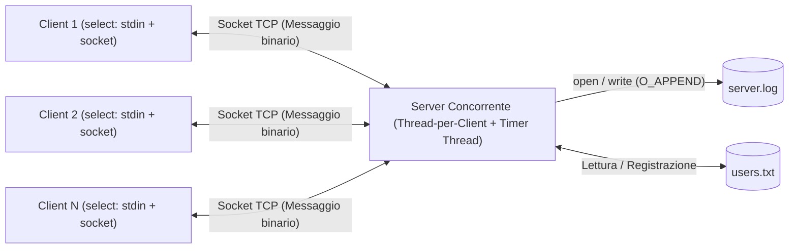
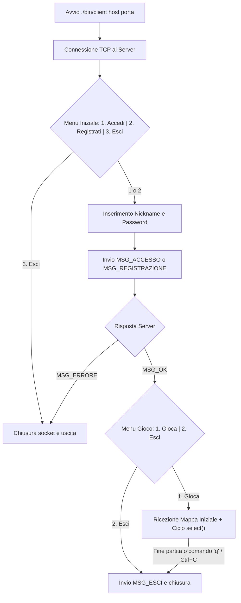
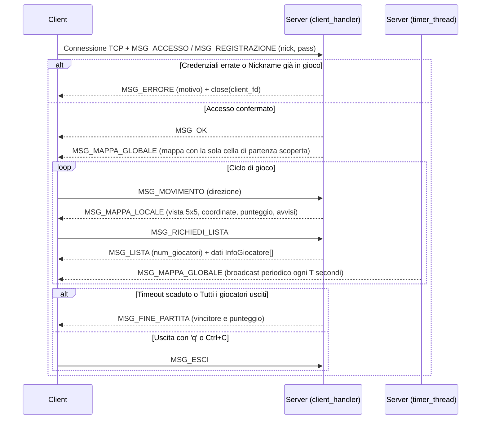
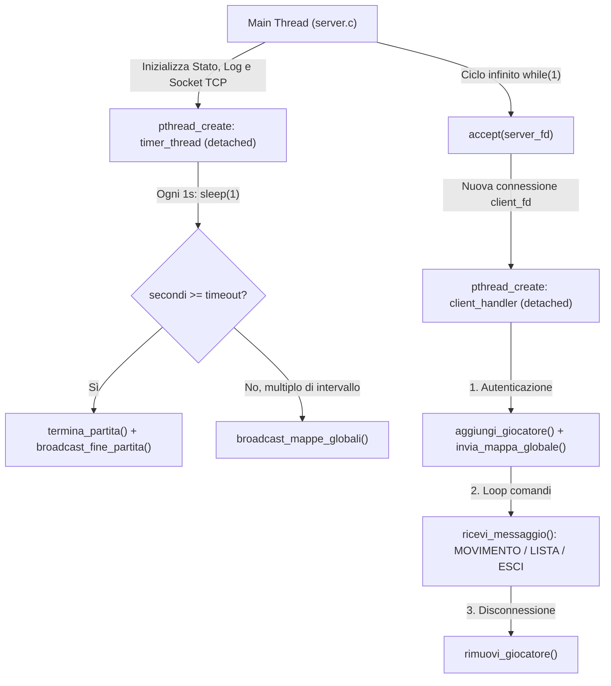
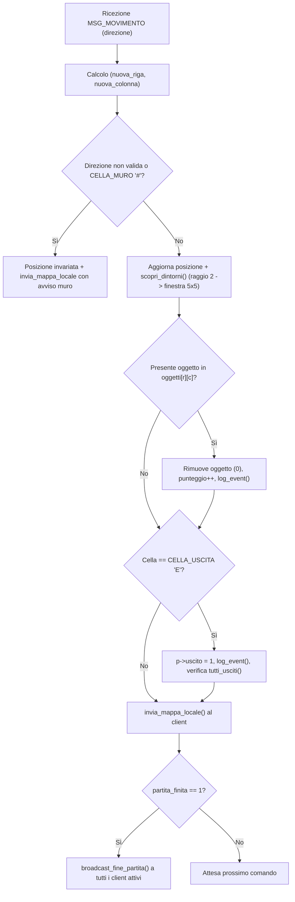
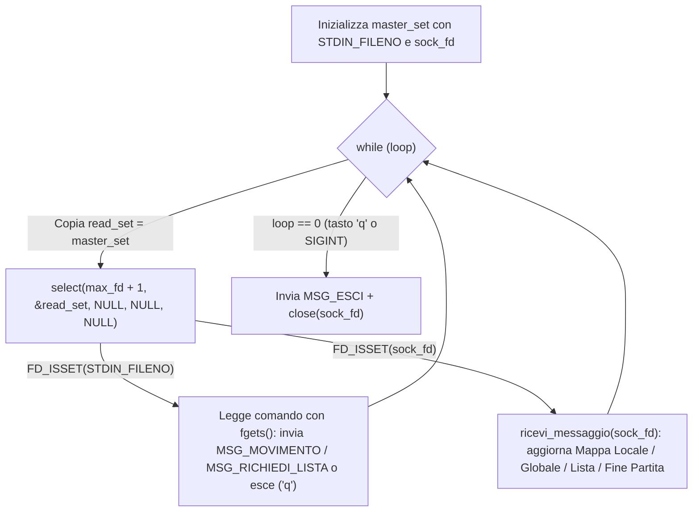

# UNIVERSITÀ DEGLI STUDI DI NAPOLI FEDERICO II
## Scuola Politecnica e delle Scienze di Base
### Dipartimento di Ingegneria Elettrica e delle Tecnologie dell'Informazione
**Corso di Laurea in Informatica — Laboratorio di Sistemi Operativi (A.A. 2025/2026)**

---

# RELAZIONE DI PROGETTO
## Traccia A — Labirinto con oggetti e uscita

**Componenti del Gruppo:**
- **Paolo Tedesco** — Email: `paol.tedesco@studenti.unina.it` — Matricola: `[Inserire Matricola]`
- **Giovanni Zapparella** — Email: `[Inserire Email]` — Matricola: `[Inserire Matricola]`

---

### Indice della Relazione
1. **Introduzione e Architettura del Sistema**
2. **Sezione 1 — Guida d'Uso per il Server e per il Client**
   - 1.1 Moduli del Progetto e Modalità di Compilazione
   - 1.2 Avvio e Configurazione del Server
   - 1.3 Avvio e Utilizzo del Client
   - 1.4 Esecuzione tramite Docker e Script di Automazione
   - 1.5 Comandi di Gioco, Interfaccia da Terminale e Regole della Partita
3. **Sezione 2 — Protocollo al Livello di Applicazione**
   - 2.1 Formato dei Messaggi e Strutture Dati Condivise (`protocol.h`)
   - 2.2 Codici Operativi (Opcode) e Significato dei Messaggi
   - 2.3 Flussi di Comunicazione Client–Server
   - 2.4 Gestione dello Stream TCP e Ricezione Dinamica (`protocol.c`)
4. **Sezione 3 — Dettagli Implementativi**
   - 3.1 Server Concorrente: Modello *Thread-per-Client* e *Timer Thread* (`server.c`)
   - 3.2 Strutture Dati di Gioco, Allocazione Dinamica e Sincronizzazione (`game.h`, `game.c`)
   - 3.3 Generazione del Labirinto, Movimento e *Fog of War*
   - 3.4 Condizioni di Terminazione e Calcolo del Vincitore
   - 3.5 Autenticazione Persistente (`users.txt`) e Logging POSIX Thread-Safe (`log.c`)
   - 3.6 Architettura del Client: `getaddrinfo()`, Multiplexing con `select()` e Gestione Segnali (`client.c`)

---

## Introduzione e Architettura del Sistema

Il progetto implementa in linguaggio C su piattaforma UNIX/Linux un gioco multigiocatore di esplorazione di un labirinto basato su architettura **Client–Server** (**Traccia A**).

Il **Server** gestisce in modo centralizzato lo stato della partita e la mappa di gioco (dimensione `21 × 41`), generata casualmente all'avvio con muri (`#`), corridoi (`.`), `15` oggetti raccoglibili (`O`) e `4` uscite (`E`) posizionate sui bordi. Per ciascun giocatore connesso, il server tiene traccia della posizione attuale, del punteggio e della porzione di mappa già esplorata (*Fog of War*): ad ogni movimento svela una finestra locale `5 × 5` attorno al giocatore e trasmette periodicamente a tutti i partecipanti la mappa globale mascherata.

Il **Client** offre un'interfaccia a riga di comando con colori ANSI. Permette all'utente di registrarsi o accedere, muoversi nel labirinto in tempo reale, visualizzare la classifica e ricevere gli aggiornamenti dal server senza mai bloccare la digitazione da tastiera.



<div style="page-break-after: always;"></div>

---

## Sezione 1 — Guida d'Uso per il Server e per il Client

### 1.1 Moduli del Progetto e Modalità di Compilazione

Il codice sorgente è suddiviso in tre moduli principali:
- `common/`: definizioni del protocollo applicativo e funzioni di supporto per la trasmissione affidabile su TCP;
- `server/`: gestione dei thread, logica del labirinto, sincronizzazione tra giocatori e logging su file;
- `client/`: gestione dell'I/O multiplexato con `select()`, rendering a terminale con colori ANSI e gestione dei comandi utente.

Completano il progetto il file `Makefile` per la compilazione e la cartella `docker/` per l'esecuzione in container.

Per compilare il progetto su ambiente Linux (o WSL su Windows), basta posizionarsi nella cartella radice `labirinto/` ed eseguire:

```bash
make
```

Il `Makefile` invoca `gcc` con i flag `-Wall -Wextra -g -pthread -Icommon`, creando la cartella `bin/` con i due eseguibili:
- `bin/server`: il processo server concorrente;
- `bin/client`: il client interattivo.

Per ripulire i file oggetto, gli eseguibili e i file di log generati:

```bash
make clean
```

---

### 1.2 Avvio e Configurazione del Server

La sintassi di avvio del server è:

```bash
./bin/server <porta> [timeout] [intervallo]
```

| Parametro | Obbligatorio | Default | Descrizione |
|-----------|:------------:|:-------:|-------------|
| `<porta>` | Sì | — | Porta TCP di ascolto del server (`1 – 65535`). |
| `[timeout]` | No | `180` s | Durata massima della partita in secondi. |
| `[intervallo]` | No | `20` s | Secondi tra due invii periodici broadcast della mappa globale mascherata. |

**Esempio di avvio:**
```bash
./bin/server 5200 300 15
```
*(Avvia il server sulla porta `5200`, con partita da `300` secondi e invio della mappa globale ogni `15` secondi).*

- Il server **non stampa nulla su `stdout`** e **non legge alcun input da `stdin`**;
- Eventuali errori critici su `stderr` vengono mostrati **solo se il server fallisce l'avvio** (es. parametri errati o porta occupata);
- Tutte le attività (avvio, registrazioni, login, movimenti, raccolta oggetti, uscite, disconnessioni e vincitore finale) vengono salvate con data e ora nel file `server.log`.

<div style="page-break-after: always;"></div>

---

### 1.3 Avvio e Utilizzo del Client

Per avviare il client occorre specificare l'indirizzo IP (o nome host) e la porta TCP del server:

```bash
./bin/client <nome_host|indirizzo_ip> <porta>
```

**Esempi:**
```bash
./bin/client localhost 5200
./bin/client 127.0.0.1 5200
```

Grazie alla funzione POSIX `getaddrinfo()`, il client accetta indifferentemente indirizzi IPv4 numerici o nomi simbolici (es. `localhost` o il nome del container Docker `server`).



---

### 1.4 Esecuzione tramite Docker e Script di Automazione

Nella cartella `docker/` è presente la configurazione per avviare il sistema con **Docker Compose**:
- Il servizio `server` avvia `./bin/server 8080 180 20` su una rete bridge dedicata (`miarete`), montando con bind-mount `users.txt` e `server.log`, applicando i limiti sulle risorse (`mem_limit: 128m`, `cpus: 0.5`, `pids_limit: 30`).
- Lo script `docker/launch_clients.py` semplifica i test: gestisce l'eventuale build, avvia il container del server e apre in automatico `N` terminali separati per i client:

```bash
cd docker
python3 launch_clients.py 0 3   # 0 = ricompila le immagini, 3 = avvia 3 client in finestre separate
``` 

```bash
cd docker
python3 launch_clients.py 1 2   # 1 = salta la build, 2 = avvia 2 client
```

---

### 1.5 Comandi di Gioco, Interfaccia da Terminale e Regole della Partita

Durante la partita, il giocatore interagisce digitando il comando e premendo `INVIO`:

| Comando | Azione eseguita |
|:-------:|-----------------|
| `w` / `a` / `s` / `d` | Movimento di una cella: Su (`w`), Sinistra (`a`), Giù (`s`), Destra (`d`) |
| `l` / `L` | Richiede la **lista dei giocatori connessi**, con relativo punteggio e stato (*in gioco* / *uscito*) |
| `h` / `H` | Mostra il riepilogo dei comandi disponibili |
| `q` / `Ctrl+C` | Invia `MSG_ESCI` al server, chiude la connessione ed esce in modo pulito |

**Elementi a schermo e colori ANSI (`client/display.c`):**
- `P` (Rosso `\033[31m`): posizione del proprio giocatore;
- `O` (Giallo `\033[33m`): oggetto raccoglibile (`+1` punto);
- `#` / `.` / `E` (Blu `\033[34m` se dentro il raggio della vista locale `5×5`, colore normale altrove): muri, corridoi liberi e uscite;
- `?`: cella non ancora esplorata (*Fog of War*).

Quando un giocatore raggiunge una delle `4` uscite, il client mostra il messaggio di completamento (*"Hai completato il labirinto"*) e resta connesso in attesa della conclusione della partita per visualizzare la proclamazione del vincitore (`MSG_FINE_PARTITA`), lasciando sempre la possibilità di uscire prima premendo `q`.

<div style="page-break-after: always;"></div>

---

## Sezione 2 — Protocollo al Livello di Applicazione

### 2.1 Formato dei Messaggi e Strutture Dati Condivise (`common/protocol.h`)

La comunicazione tra client e server si basano sullo scambio di strutture definite nell'header condiviso [`protocol.h`]. Per quasi tutte le operazioni viene impiegata una singola struct a dimensione fissa, `Messaggio`, affiancata dalla struct `InfoGiocatore` impiegata per la trasmissione della classifica:

```c
/* Dimensioni della mappa e della finestra locale */
#define RIGHE_MAPPA       21
#define COLONNE_MAPPA     41
#define VISTA_LOCALE      5
#define RAGGIO_VISIBILITA (VISTA_LOCALE / 2)

/* Limiti buffer testuali */
#define MAX_NICK          32
#define MAX_PASS          32
#define MAX_TESTO         128

/* Dati del singolo giocatore per la classifica (MSG_LISTA) */
typedef struct {
    char nickname[MAX_NICK];
    int  punteggio;
    int  uscito;
} InfoGiocatore;

/* Messaggio applicativo scambiato tra client e server */
typedef struct {
    int  tipo;                                          /* Codice identificativo del messaggio (MSG_*) */
    char nickname[MAX_NICK];                            /* Nickname utente o vincitore */
    char password[MAX_PASS];                            /* Password per login o registrazione */
    char direzione;                                     /* Direzione di movimento: 'w','a','s','d' */
    char testo[MAX_TESTO];                              /* Messaggio informativo o descrizione dell'errore */
    int  riga;                                          /* Coordinata riga corrente */
    int  colonna;                                       /* Coordinata colonna corrente */
    int  punteggio;                                     /* Punteggio attuale (oggetti raccolti) */
    
    char mappa_locale[VISTA_LOCALE][VISTA_LOCALE];      /* Vista 5x5 attorno al giocatore */
    char mappa_globale[RIGHE_MAPPA][COLONNE_MAPPA];     /* Mappa intera mascherata con la Fog of War */
    
    int  num_giocatori;                                 /* Numero di elementi InfoGiocatore che seguono */
} Messaggio;
```

L'uso di una struttura unificata a dimensione fissa rende la gestione dei socket molto semplice: per qualsiasi messaggio standard, il processo legge o scrive esattamente `sizeof(Messaggio)` byte. Ispezionando `msg.tipo`, il destinatario accede unicamente ai campi rilevanti per quella richiesta o risposta. L'unica eccezione è `MSG_LISTA`, in cui alla struct `Messaggio` segue immediatamente sullo stream TCP un blocco di `msg.num_giocatori * sizeof(InfoGiocatore)` byte.

---

### 2.2 Codici Operativi (Opcode) e Significato dei Messaggi

Il protocollo prevede **12 codici messaggio**, distinti tra richieste inviate dal Client (`1 – 5`) e risposte/notifiche trasmesse dal Server (`10 – 16`):

| Costante | Codice | Direzione | Campi Usati in `Messaggio` | Significato |
|--------------------|:------:|:---------:|------------------------------------|---------------------|
| `MSG_ACCESSO` | `1` | Client $\rightarrow$ Server | `nickname`, `password` | Richiesta di login per un utente registrato in `users.txt`. |
| `MSG_MOVIMENTO` | `2` | Client $\rightarrow$ Server | `direzione` (`'w'`,`'a'`,`'s'`,`'d'`) | Richiesta di spostamento di una casella nella direzione scelta. |
| `MSG_RICHIEDI_LISTA` | `3` | Client $\rightarrow$ Server | *(nessun campo)* | Richiesta dell'elenco aggiornato dei giocatori connessi. |
| `MSG_ESCI` | `4` | Client $\rightarrow$ Server | *(nessun campo)* | Notifica di uscita dal gioco (comando `q` o segnale `SIGINT`). |
| `MSG_REGISTRAZIONE` | `5` | Client $\rightarrow$ Server | `nickname`, `password` | Registrazione di un nuovo profilo utente su `users.txt`. |
| `MSG_OK` | `10` | Server $\rightarrow$ Client | *(nessun campo)* | Conferma del corretto login o dell'avvenuta registrazione. |
| `MSG_ERRORE` | `11` | Server $\rightarrow$ Client | `testo` | Segnalazione di errore (es. password errata, utente già online, partita chiusa). |
| `MSG_MAPPA_LOCALE` | `12` | Server $\rightarrow$ Client | `riga`, `colonna`, `punteggio`, `mappa_locale`, `testo` | Risposta a `MSG_MOVIMENTO`: contiene la vista `5×5` aggiornata e un eventuale avviso. |
| `MSG_MAPPA_GLOBALE` | `13` | Server $\rightarrow$ Client | `riga`, `colonna`, `punteggio`, `mappa_locale`, `mappa_globale` | Inviato al login e periodicamente dal `timer_thread` ogni `T` secondi. |
| `MSG_LISTA` | `14` | Server $\rightarrow$ Client | `num_giocatori` + blocco `InfoGiocatore[]` | Restituisce il conteggio degli utenti seguito dall'array dinamico dei loro stati. |
| `MSG_FINE_PARTITA` | `15` | Server $\rightarrow$ Client | `nickname`, `punteggio` | Broadcast finale: indica il nickname e il punteggio del vincitore. |
| `MSG_NOTIFICA` | `16` | Server $\rightarrow$ Client | `testo` | Messaggio informativo generico inviato dal server al client. |

<div style="page-break-after: always;"></div>

---

### 2.3 Flussi di Comunicazione Client–Server

Il diagramma di sequenza seguente riassume lo scambio dei messaggi durante il ciclo di vita della partita:



---

### 2.4 Gestione dello Stream TCP e Ricezione Dinamica (`common/protocol.c`)

Poiché TCP è un protocollo di trasporto orientato al flusso di byte (*byte-stream*) e non preserva i confini dei messaggi a livello applicativo, una chiamata a `read()` o `write()` non garantisce di trasferire tutti i byte richiesti in una sola operazione (*short read* e *short write*). Inoltre, l'arrivo di un segnale durante l'I/O può interrompere temporaneamente la system call con codice di errore `EINTR`.

Per garantire che ogni messaggio venga trasmesso o ricevuto per intero, il modulo `protocol.c` implementa le funzioni `invia_dati()` e `ricevi_dati()`, che iterano finché non sono stati trasferiti esattamente tutti i byte necessari:

```c
/* Invia esattamente len byte sul socket, gestendo short write ed EINTR */
int invia_dati(int fd, const void *buf, size_t len) {
    const char *p = (const char *)buf;
    size_t rimanenti = len;

    while (rimanenti > 0) {
        ssize_t n = write(fd, p, rimanenti);
        if (n <= 0) {
            if (n < 0 && errno == EINTR)
                continue;
            return -1;
        }
        p += n;
        rimanenti -= n;
    }
    return 0;
}

/* Riceve esattamente len byte dal socket, gestendo short read, EOF ed EINTR */
int ricevi_dati(int fd, void *buf, size_t len) {
    char *p = (char *)buf;
    size_t rimanenti = len;

    while (rimanenti > 0) {
        ssize_t n = read(fd, p, rimanenti);
        if (n == 0)
            return 0; /* Connessione chiusa dall'altro estremo (EOF) */
        if (n < 0) {
            if (errno == EINTR)
                continue;
            return -1;
        }
        p += n;
        rimanenti -= n;
    }
    return 1;
}
```

#### Gestione dinamica della lista giocatori (`MSG_LISTA`)
La traccia del progetto specifica che non ci deve essere un limite prefissato al numero di utenti collegabili contemporaneamente. Di conseguenza, la lista dei giocatori non usa un array statico di grandezza fissa dentro `Messaggio`. In [`game.c`] viene usata la struttura di supporto `MessaggioLista`:
1. Il **Server** conta i giocatori attivi (`totale`), alloca un buffer con `sizeof(MessaggioLista) + totale * sizeof(InfoGiocatore)`, imposta `ml->msg.tipo = MSG_LISTA` e `ml->msg.num_giocatori = totale`, popola gli elementi dell'array e trasmette il tutto con una singola chiamata a `invia_dati()`.
2. Il **Client**, quando riceve un `Messaggio` con `msg.tipo == MSG_LISTA`, legge il valore di `msg.num_giocatori`, alloca con `malloc` un buffer per contenere i relativi `InfoGiocatore` e chiama `ricevi_dati(sock_fd, lista, msg.num_giocatori * sizeof(InfoGiocatore))`. Subito dopo aver formattato e mostrato a video la classifica, il client esegue `free(lista)`, evitando così qualsiasi memory leak.

<div style="page-break-after: always;"></div>

---

## Sezione 3 — Dettagli Implementativi

### 3.1 Server Concorrente: Modello *Thread-per-Client* e *Timer Thread* (`server/server.c`)

Il server deve portare avanti tre compiti simultanei senza mai bloccarsi:
1. Accettare nuove connessioni dai client sulla porta in ascolto;
2. Ricevere ed elaborare i comandi di gioco inviati da ciascun utente connesso;
3. Gestire il conto alla rovescia della partita e spedire periodicamente la mappa a tutti.

Per gestire queste attività in modo pulito e concorrente, [`server.c`] adotta un'architettura multithread con thread POSIX creati in stato *detached* (`pthread_detach`):



#### Uso di `pthread_detach()` per il recupero delle risorse
Tutti i thread secondari (`client_handler` per ciascun client e il `timer_thread`) vengono impostati come *detached*. Questa scelta è fondamentale: quando un client si disconnette e il relativo thread termina, le sue risorse nel kernel vengono rilasciate subito in automatico. In questo modo il thread principale non deve occuparsi di fare `pthread_join()`, potendo rimanere sempre in ascolto bloccato sulla `accept()` per accogliere nuovi giocatori.

#### Configurazione della Socket di Ascolto
La funzione `create_server_socket()` apre una socket `AF_INET` di tipo `SOCK_STREAM`. Prima della `bind()`, imposta l'opzione `SO_REUSEADDR` tramite `setsockopt()`, permettendo il riavvio immediato del server sulla stessa porta senza dover attendere che scada il tempo di `TIME_WAIT` del kernel. Infine, attiva la coda di ascolto con `listen(server_fd, 16)`.

---

### 3.2 Strutture Dati di Gioco, Allocazione Dinamica e Sincronizzazione (`server/game.h`, `server/game.c`)

Lo stato completo della partita è racchiuso nella variabile globale condivisa `StatoGioco partita`, definita in [`game.h`]:

```c
/* Struttura del labirinto */
typedef struct {
    char celle[RIGHE_MAPPA][COLONNE_MAPPA];      /* Muri '#', corridoi '.', uscite 'E' */
    char oggetti[RIGHE_MAPPA][COLONNE_MAPPA];    /* 1 se presente l'oggetto 'O', altrimenti 0 */
} Labirinto;

/* Dati del singolo giocatore */
typedef struct {
    int  fd;                                     /* Socket TCP aperta verso il client */
    int  attivo;                                 /* 1 se online, 0 se disconnesso */
    int  partecipante;                           /* 1 se ha partecipato alla partita */
    int  uscito;                                 /* 1 se ha raggiunto un'uscita 'E' */
    char nickname[MAX_NICK];
    int  riga, colonna;                          /* Posizione attuale nel labirinto */
    int  punteggio;                              /* Oggetti raccolti */
    char scoperte[RIGHE_MAPPA][COLONNE_MAPPA];   /* Matrice Fog of War personale */
} Giocatore;

/* Stato complessivo della partita */
typedef struct {
    Labirinto labirinto;
    Giocatore *giocatori;                        /* Array dinamico dei giocatori */
    int  num_giocatori;                          /* Capacità attuale dell'array */
    int  partita_finita;                         /* 1 se la partita è terminata */
    int  vincitore;                              /* Indice del vincitore (-1 se nessuno) */
    int  timeout;                                /* Durata totale in secondi */
    int  intervallo;                             /* Intervallo broadcast mappa in secondi */
    pthread_mutex_t mutex;                       /* Mutex per l'accesso allo stato di gioco */
} StatoGioco;
```

#### Gestione Dinamica dell'Array Giocatori (`realloc`)
Per non porre alcun limite rigido al numero di utenti collegabili, l'array `partita.giocatori` è gestito dinamicamente in `aggiungi_giocatore()`:
1. Quando un utente accede, il server cerca innanzitutto se esiste uno slot non più attivo (`!partita.giocatori[i].attivo`) lasciato libero da un giocatore disconnesso in precedenza.
2. Se tutti gli slot allocati risultano occupati, l'array viene espanso tramite `realloc()`, partendo da `8` posizioni e raddoppiando la capacità (`partita.num_giocatori * 2`) ad ogni saturazione.

#### Sincronizzazione e Invio su Socket Fuori Sezione Critica
Dato che più thread `client_handler` e il `timer_thread` accedono contemporaneamente alla variabile `partita`, ogni operazione di lettura e modifica dello stato è protetta dal mutex `partita.mutex`.

Tuttavia, **le scritture di rete (`invia_messaggio` / `invia_dati`) non vengono mai eseguite tenendo bloccato il mutex di gioco**:
- Il thread acquisisce il lock con `pthread_mutex_lock(&partita.mutex)`, copia i dati necessari in variabili locali (o estrae i descrittori dei socket attivi) e **rilascia subito il mutex** con `pthread_mutex_unlock(&partita.mutex)`.
- Solo dopo aver rilasciato il lock, procede con le chiamate di invio su socket.

Questa strategia è essenziale in un server di rete: se un client ha una connessione lenta, la relativa chiamata di scrittura sul socket non blocca l'accesso alla partita per tutti gli altri partecipanti.

Inoltre, **non ci sono rischi di deadlock** tra il mutex di gioco `partita.mutex` e il mutex di tracciamento `log_mutex`: i due blocchi sono completamente distinti e non vengono mai annidati (nessuna funzione tenta di acquisire un mutex mentre tiene già occupato l'altro).

---

### 3.3 Generazione del Labirinto, Movimento e *Fog of War*

#### Generazione del Labirinto (`genera_labirinto`)
All'avvio del server, `genera_labirinto()` costruisce la mappa di dimensione `21 × 41` utilizzando una variante dell'algoritmo **Binary Tree Maze**:
1. L'intera griglia viene inizializzata con muri `CELLA_MURO` (`'#'`) e la matrice degli oggetti viene azzerata.
2. Si scandiscono tutte le celle con indici dispari `(r, c)` per `r ∈ [1, 19]` e `c ∈ [1, 39]`: ciascuna viene impostata come libera `CELLA_LIBERA` (`'.'`) e viene aperto a caso un passaggio o verso l'alto (`r - 1`) o verso sinistra (`c - 1`). Questo approccio assicura che tutte le stanze libere siano reciprocamente collegate (nessuna cella resta isolata).
3. Vengono collocate **4 uscite** `CELLA_USCITA` (`'E'`) al centro dei 4 bordi esterni: `(0, 20)`, `(20, 20)`, `(10, 0)` e `(10, 40)`, assicurandosi che la cella interna adiacente sia sempre libera.
4. Vengono infine posizionati `15` oggetti raccoglibili (`'O'`) in coordinate casuali libere e distinte tra loro.

<div style="page-break-after: always;"></div>

---

#### Movimento e *Fog of War* (`muovi_giocatore`, `scopri_dintorni`)
Al momento dell'accesso, il giocatore viene posizionato in una cella libera casuale e inizialmente vede solo la propria casella (`p->scoperte[riga][colonna] = 1`).
Quando il client invia un messaggio di movimento `MSG_MOVIMENTO`, il server esegue `muovi_giocatore()`, il cui flusso è rappresentato nello schema:



Ad ogni passo effettuato con successo, la funzione `scopri_dintorni()` imposta a `1` le celle scoperte nella matrice personale `p->scoperte[r][c]` nel quadrato di raggio `RAGGIO_VISIBILITA = 2`. Quando il server compone la vista locale o la mappa globale per quel client, tutte le celle con valore `0` vengono sostituite con il carattere nasconditore `CELLA_NASCOSTA` (`'?'`). La vera conformazione del labirinto rimane così protetta sul server.

---

### 3.4 Condizioni di Terminazione e Calcolo del Vincitore (`trova_vincitore`)

La partita si chiude non appena si verifica una delle due condizioni:
1. **Scadenza del tempo massimo**: rilevata dal `timer_thread` quando il contatore dei secondi raggiunge il valore di `partita.timeout`;
2. **Uscita di tutti i giocatori**: rilevata da `tutti_usciti()` quando tutti gli utenti ancora attivi nel labirinto raggiungono un'uscita `'E'` (oppure si disconnettono lasciando in partita solo utenti già usciti).

Al termine della partita, `termina_partita()` chiama `trova_vincitore()`, che applica le seguenti regole:

```c
static int trova_vincitore(void) {
    int usciti = 0;
    int ultimo_uscito = -1;

    for (int i = 0; i < partita.num_giocatori; i++) {
        if (partita.giocatori[i].uscito) {
            usciti++;
            ultimo_uscito = i;
        }
    }

    /* Caso 1: è uscito un solo giocatore -> ha vinto lui */
    if (usciti == 1)
        return ultimo_uscito;

    int migliore = -1;
    int punteggio_max = -1;

    /* Caso 2: sono usciti più giocatori -> vince chi ha più punti tra quelli usciti */
    if (usciti > 1) {
        for (int i = 0; i < partita.num_giocatori; i++) {
            if (partita.giocatori[i].uscito &&
                partita.giocatori[i].punteggio > punteggio_max) {
                punteggio_max = partita.giocatori[i].punteggio;
                migliore = i;
            }
        }
        return migliore;
    }

    /* Caso 3: nessuno è uscito in tempo -> vince chi ha raccolto più oggetti in assoluto */
    for (int i = 0; i < partita.num_giocatori; i++) {
        if (partita.giocatori[i].partecipante &&
            partita.giocatori[i].punteggio > punteggio_max) {
            punteggio_max = partita.giocatori[i].punteggio;
            migliore = i;
        }
    }
    return migliore;
}
```

<div style="page-break-after: always;"></div>

---

### 3.5 Autenticazione Persistente (`users.txt`) e Logging POSIX Thread-Safe (`server/log.c`)

#### Autenticazione Persistente (`autentica_utente`)
La funzione `autentica_utente()` gestisce le credenziali inviate dai client durante la fase iniziale:
- Se riceve `MSG_ACCESSO`, scorre `users.txt` riga per riga: se il nickname non esiste restituisce errore `-5` (*"Utente non registrato"*); se la password non coincide restituisce `-4` (*"Password errata"*); se i dati sono corretti, controlla che quell'utente non sia già attualmente connesso nel labirinto (`-2`, *"Nickname già connesso"*).
- Se riceve `MSG_REGISTRAZIONE`, controlla prima che il nickname non sia già presente nel file (altrimenti restituisce `-6`, *"Nickname già registrato"*); se è libero, apre `users.txt` in modalità append, inserisce la nuova riga `<nickname> <password>\n` e registra l'evento nel log.

#### Logging Thread-Safe (`log.c`)
Il modulo di logging è realizzato usando le system call dirette POSIX `open()` e `write()`, protette da un mutex dedicato `log_mutex`:

```c
static int log_fd = -1;
static pthread_mutex_t log_mutex = PTHREAD_MUTEX_INITIALIZER;

int log_open(const char *path) {
    log_fd = open(path, O_WRONLY | O_CREAT | O_APPEND, 0644);
    if (log_fd < 0)
        return -1;
    return 0;
}

void log_event(const char *msg) {
    if (log_fd < 0)
        return;

    pthread_mutex_lock(&log_mutex);

    time_t now = time(NULL);
    char ts[32];
    strftime(ts, sizeof(ts), "%Y-%m-%d %H:%M:%S", localtime(&now));

    char log_line[512];
    int n = snprintf(log_line, sizeof(log_line), "[%s] %s\n", ts, msg);
    if (n > 0)
        write(log_fd, log_line, n);

    pthread_mutex_unlock(&log_mutex);
}
```

La scelta di usare `open()` con il flag `O_APPEND` combinato con `log_mutex` garantisce che le scritture contemporanee provenienti dai vari thread non si accavallino e non sovrascrivano i dati, producendo un file `server.log` coerente e ordinato nel tempo:

```text
[2026-11-08 12:30:01] Server avviato sulla porta 5200 (timeout=180, intervallo=20).
[2026-11-08 12:30:10] Nuovo utente registrato: 'paolo'.
[2026-11-08 12:30:10] Nuova connessione: 'paolo' (riga 11, colonna 25, slot 0).
[2026-11-08 12:30:18] paolo ha raccolto un oggetto in (11,27), punteggio=1.
[2026-11-08 12:30:45] paolo ha raggiunto l'uscita con punteggio=1.
[2026-11-08 12:30:45] Fine partita. Vincitore: paolo con 1 oggetti.
```

<div style="page-break-after: always;"></div>

---

### 3.6 Architettura del Client: `getaddrinfo()`, Multiplexing con `select()` e Gestione Segnali (`client/client.c`)

#### Risoluzione Indirizzi con `getaddrinfo()`
All'avvio, il client risolve il parametro `<nome_host|indirizzo_ip>` tramite `getaddrinfo()`, configurando `hints.ai_family = AF_INET` e `hints.ai_socktype = SOCK_STREAM`. Il programma scorre la lista concatenata `struct addrinfo *res`, prova `socket()` e `connect()` finché non si connette con successo al primo indirizzo valido, e libera infine la struttura con `freeaddrinfo(res)`.

#### Multiplexing di I/O con `select()`
Durante il gioco, il client deve ascoltare contemporaneamente due canali di I/O senza bloccarsi su nessuno dei due:
1. Lo standard input `STDIN_FILENO`: da cui legge i comandi digitati dal giocatore;
2. Il socket di rete `sock_fd`: da cui riceve sia le risposte immediate ai comandi (`MSG_MAPPA_LOCALE`, `MSG_LISTA`), sia i messaggi asincroni inviati dal server (`MSG_MAPPA_GLOBALE` periodica e `MSG_FINE_PARTITA`).

Se il client facesse una normale lettura bloccante da tastiera (`fgets` o `scanf`), resterebbe fermo in attesa dell'utente e non potrebbe mostrare né le mappe globali inviate dal server né la notifica di fine partita. Per questo motivo, [`client.c`] impiega la system call **`select()`**:



```c
fd_set master_set, read_set;
FD_ZERO(&master_set);
FD_SET(STDIN_FILENO, &master_set);
FD_SET(sock_fd, &master_set);
int max_fd = (sock_fd > STDIN_FILENO) ? sock_fd : STDIN_FILENO;

while (loop) {
    read_set = master_set;
    int activity = select(max_fd + 1, &read_set, NULL, NULL, NULL);
    if (activity < 0) {
        if (errno == EINTR)
            continue;
        perror("select");
        close(sock_fd);
        return 1;
    }

    if (FD_ISSET(STDIN_FILENO, &read_set)) {
        /* Lettura ed elaborazione immediata del comando da tastiera */
    }
    if (FD_ISSET(sock_fd, &read_set)) {
        /* Lettura ed elaborazione immediata dei pacchetti arrivati dal server */
    }
}
```

#### Gestione dei Segnali POSIX (`SIGINT`, `SIGTERM`, `SIGPIPE`)
Sia nel client che nel server viene impostato `signal(SIGPIPE, SIG_IGN)`: questo evita che un tentativo di scrittura su un socket chiuso improvvisamente dal peer generi il segnale `SIGPIPE` con conseguente crash del processo, consentendo alla `write()` di fallire normalmente restituendo `-1` con `errno == EPIPE`.

Nel client, la chiusura da tastiera (`Ctrl+C` / `SIGINT`) e la terminazione (`SIGTERM`) sono gestite da una variabile atomica e da un apposito handler:

```c
static volatile sig_atomic_t loop = 1;

static void sigint_handler(int sig) {
    (void)sig;
    loop = 0;
}
```

L'uso del tipo `volatile sig_atomic_t` è fondamentale per la correttezza del codice:
1. `sig_atomic_t` garantisce che la lettura e la scrittura della variabile avvengano in una singola operazione atomica, senza il rischio che l'arrivo del segnale interrompa l'istruzione a metà;
2. `volatile` ordina al compilatore di non ottimizzare la variabile memorizzandola in un registro della CPU, obbligandolo a rileggerne il valore reale dalla memoria principale ad ogni ciclo.

Quando l'utente preme `Ctrl+C`, l'handler si limita a impostare `loop = 0`. La `select()` viene interrotta restituendo errore con `errno == EINTR`; il ciclo `while (loop)` termina regolarmente e il client invia il messaggio di chiusura `MSG_ESCI` al server prima di chiudere il socket e terminare in modo pulito.
