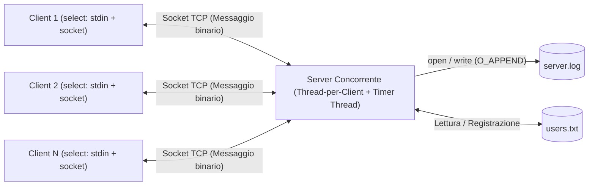
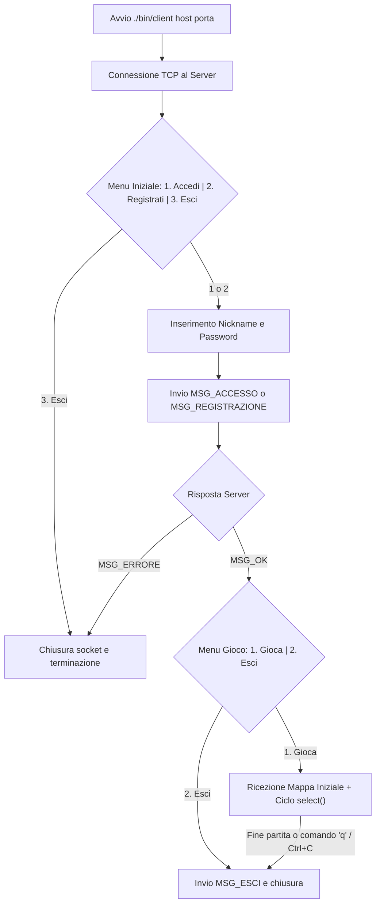
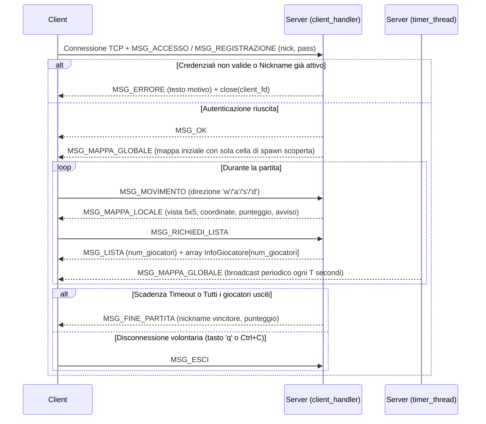
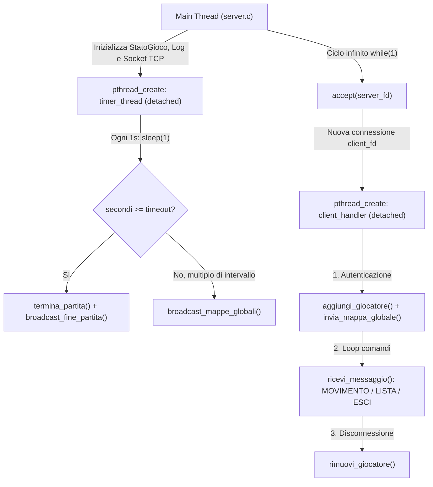
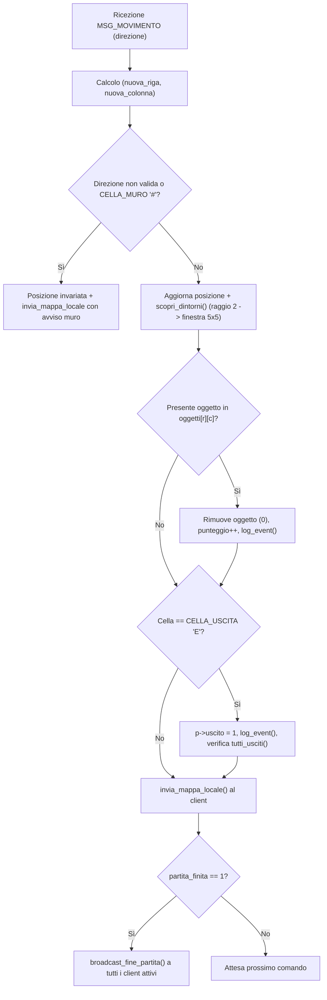
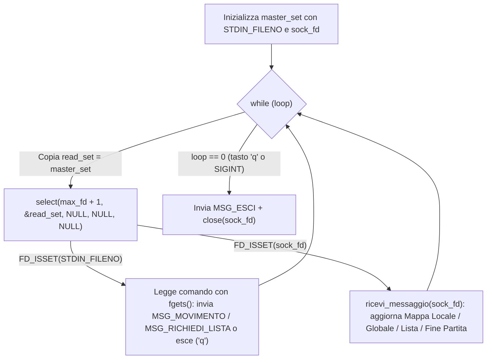

# UNIVERSITÀ DEGLI STUDI DI NAPOLI FEDERICO II
## Scuola Politecnica e delle Scienze di Base
### Dipartimento di Ingegneria Elettrica e delle Tecnologie dell'Informazione
**Corso di Laurea in Informatica — Laboratorio di Sistemi Operativi (A.A. 2025/2026)**

---

# RELAZIONE DI PROGETTO
## Traccia A — Labirinto con oggetti e uscita

**Componenti del Gruppo:**
- **Paolo Tedesco** — Email: `paol.tedesco@studenti.unina.it` — Matricola: `[Inserire Matricola]`
- **Giovanni Zapparella** — Email: `[Inserire Email]` — Matricola: `[Inserire Matricola]`

---

### Indice della Relazione
1. **Introduzione e Architettura del Sistema** *(Pag. 1)*
2. **Sezione 1 — Guida d'Uso per il Server e per il Client** *(Pag. 2 – 3)*
   - 1.1 Struttura del Progetto e Modalità di Compilazione
   - 1.2 Avvio e Configurazione del Server
   - 1.3 Avvio e Utilizzo del Client
   - 1.4 Esecuzione Containerizzata tramite Docker e Script di Automazione
   - 1.5 Comandi di Gioco, Interfaccia Grafica da Terminale e Regole della Partita
3. **Sezione 2 — Protocollo al Livello di Applicazione** *(Pag. 4 – 5)*
   - 2.1 Formato dei Messaggi e Strutture Dati Condivise (`protocol.h`)
   - 2.2 Codici Operativi (Opcode) e Semantica dei Messaggi
   - 2.3 Flussi di Comunicazione Client–Server
   - 2.4 Gestione Affidabile dello Stream TCP e Messaggi a Lunghezza Variabile (`protocol.c`)
4. **Sezione 3 — Dettagli Implementativi** *(Pag. 6 – 10)*
   - 3.1 Server Concorrente: Modello *Thread-per-Client* e *Timer Thread* (`server.c`)
   - 3.2 Strutture Dati di Gioco, Allocazione Dinamica e Sincronizzazione (`game.h`, `game.c`)
   - 3.3 Generazione Procedurale del Labirinto, Movimento e *Fog of War*
   - 3.4 Condizioni di Terminazione e Calcolo del Vincitore
   - 3.5 Autenticazione Persistente (`users.txt`) e Logging POSIX Thread-Safe (`log.c`)
   - 3.6 Architettura del Client: `getaddrinfo()`, Multiplexing con `select()` e Gestione Segnali (`client.c`)

---

## 1. Introduzione e Architettura del Sistema

Il progetto implementa in linguaggio C su piattaforma UNIX/Linux un sistema distribuito basato sul paradigma **Client–Server** per la gestione di un gioco multigiocatore concorrente di esplorazione di un labirinto bidimensionale (**Traccia A**).

Il **Server** mantiene in modo centralizzato lo stato della partita e l'intera mappa 2D (dimensione `21 × 41`), generata proceduralmente all'avvio con muri (`#`), corridoi calpestabili (`.`), `15` oggetti raccoglibili (`O`) e `4` uscite (`E`) collocate sui bordi. Per ciascun giocatore connesso il server conserva la posizione corrente, il punteggio e una matrice personale di visibilità (*Fog of War*), rivelando ad ogni passo una finestra locale `5 × 5` centrata sul giocatore e trasmettendo periodicamente a tutti i partecipanti la mappa globale mascherata.

Il **Client** fornisce un'interfaccia interattiva da terminale con colorazione ANSI, consentendo all'utente di registrarsi o autenticarsi, esplorare il labirinto in tempo reale, consultare la classifica dei giocatori attivi e ricevere in modo asincrono gli aggiornamenti periodici del server senza bloccare l'input da tastiera.



<div style="page-break-after: always;"></div>

---

## 2. Sezione 1 — Guida d'Uso per il Server e per il Client

### 1.1 Struttura del Progetto e Modalità di Compilazione

Il codice sorgente è organizzato in tre moduli principali (`common/`, `server/`, `client/`), affiancati dal `Makefile` e dalla configurazione `docker/`:

```text
labirinto/
├── Makefile                 # Script di compilazione per server e client
├── users.txt                # Archivio persistente delle credenziali (nickname e password)
├── server.log               # File di log generato e aggiornato dal server
├── common/
│   ├── protocol.h           # Costanti, codici messaggio (MSG_*) e struct Messaggio / InfoGiocatore
│   └── protocol.c           # Funzioni di I/O su socket (invia_dati, ricevi_dati, invia/ricevi_messaggio)
├── server/
│   ├── server.c             # Creazione socket TCP, ciclo accept(), client_handler e timer_thread
│   ├── game.h / game.c      # Generazione labirinto, autenticazione, movimento, viste e calcolo vincitore
│   └── log.h / log.c        # Logging thread-safe tramite system call POSIX open() e write()
├── client/
│   ├── client.c             # Risoluzione host getaddrinfo(), menu, select() su stdin/socket, segnali
│   └── display.h / display.c# Rendering a colori ANSI della mappa locale, globale e lista giocatori
└── docker/
    ├── Dockerfile.server    # Immagine container per il server
    ├── Dockerfile.client    # Immagine container per il client
    ├── docker-compose.yml   # Orchestrazione rete virtuale 'miarete', volumi e limiti di risorse
    └── launch_clients.py    # Script Python per l'avvio automatico di N client in terminali separati
```

Per compilare l'intero progetto su ambiente Linux (o WSL su Windows), posizionarsi nella directory radice `labirinto/` ed eseguire:

```bash
make
```

Il `Makefile` utilizza il compilatore `gcc` con i flag `-Wall -Wextra -g -pthread -Icommon`, generando automaticamente la cartella `bin/` e i due eseguibili:
- `bin/server`: eseguibile del server concorrente;
- `bin/client`: eseguibile del client interattivo.

Per rimuovere gli eseguibili compilati e il file di log generato:

```bash
make clean
```

---

### 1.2 Avvio e Configurazione del Server

La sintassi di avvio del server è la seguente:

```bash
./bin/server <porta> [timeout] [intervallo]
```

| Parametro | Obbligatorio | Default | Descrizione |
|-----------|:------------:|:-------:|-------------|
| `<porta>` | Sì | — | Porta TCP su cui il server si pone in ascolto (`1 – 65535`). |
| `[timeout]` | No | `180` s | Durata massima complessiva della partita espressa in secondi. |
| `[intervallo]` | No | `20` s | Periodo (in secondi) tra due invii broadcast consecutivi della mappa globale. |

**Esempio di avvio:**
```bash
./bin/server 5200 300 15
```
*(Avvia il server sulla porta TCP `5200`, con durata partita di `300` secondi e broadcast della mappa globale ogni `15` secondi).*

In stretta conformità con le regole generali della traccia:
- Il server **non invia alcun output su `stdout`** e **non legge alcun input da `stdin`**.
- Eventuali messaggi su `stderr` vengono emessi **esclusivamente in caso di terminazione anomala all'avvio** (es. parametri da riga di comando mancanti o porta già occupata).
- Tutte le attività operative (avvio del server, registrazioni, login, fallimenti di autenticazione, posizioni di spawn, raccolta oggetti, raggiungimento dell'uscita, disconnessioni e proclamazione del vincitore) vengono registrate con data e ora nel file `server.log`.

<div style="page-break-after: always;"></div>

---

### 1.3 Avvio e Utilizzo del Client

La sintassi di avvio del client richiede l'indicazione del nome simbolico o dell'indirizzo IP del server e della relativa porta TCP:

```bash
./bin/client <nome_host|indirizzo_ip> <porta>
```

**Esempi di avvio:**
```bash
./bin/client localhost 5200
./bin/client 127.0.0.1 5200
```

Grazie all'uso della primitiva POSIX `getaddrinfo()`, il client risolve in modo trasparente sia nomi host simbolici (es. `localhost` o il nome del servizio container `server` nella rete Docker) sia indirizzi IPv4 numerici.



---

### 1.4 Esecuzione Containerizzata tramite Docker e Script di Automazione

Per agevolare il testing multi-client e l'isolamento dell'ambiente di esecuzione, la cartella `docker/` mette a disposizione un'infrastruttura completa basata su **Docker Compose**:
- Il servizio `server` compila ed esegue `./bin/server 8080 180 20` su una rete bridge dedicata (`miarete`), montando in bind-mount i file `../users.txt` e `../server.log` affinché le credenziali e i log siano immediatamente ispezionabili sull'host, ed applicando limiti di sicurezza (`mem_limit: 128m`, `cpus: 0.5`, `pids_limit: 30`).
- Lo script `docker/launch_clients.py` automatizza la build opzionale, l'avvio in background del container `server` e l'apertura simultanea di `N` finestre terminale per i client:

```bash
cd docker
python3 launch_clients.py 0 3   # 0 = esegue la build delle immagini, 3 = avvia 3 client concorrenti
```

---

### 1.5 Comandi di Gioco, Interfaccia da Terminale e Regole della Partita

Una volta entrato in partita, il giocatore interagisce tramite comandi testuali a singolo carattere seguiti da `INVIO`:

| Comando | Azione eseguita |
|:-------:|-----------------|
| `w` / `a` / `s` / `d` | Sposta il giocatore di una cella verso **Nord (Su)**, **Ovest (Sinistra)**, **Sud (Giù)** o **Est (Destra)**. |
| `l` | Richiede al server e visualizza la **lista aggiornata dei giocatori connessi**, il punteggio e lo stato (*in gioco* / *uscito*). |
| `h` | Mostra a schermo il riepilogo dei comandi disponibili. |
| `q` oppure `Ctrl+C` | Invia il messaggio `MSG_ESCI` al server, chiude ordinatamente la socket TCP e termina il client. |

**Simboli e codifica cromatica (`client/display.c`):**
- `P` (**Rosso ANSI** `\033[31m`): posizione attuale del giocatore;
- `O` (**Giallo ANSI** `\033[33m`): oggetto raccoglibile (`+1` punto);
- `#` / `.` / `E` (**Blu ANSI** `\033[34m` se all'interno del raggio `5×5` della vista locale, colore standard altrove): muro, cella libera, uscita del labirinto;
- `?`: cella non ancora esplorata dal giocatore (*Fog of War*).

Quando un giocatore raggiunge una delle `4` uscite (`E`), il client mostra la schermata di completamento (`Hai completato il labirinto!`) e resta in attesa della conclusione della partita per visualizzare la notifica finale con il vincitore (`MSG_FINE_PARTITA`), permettendo comunque l'uscita anticipata con `q`.

<div style="page-break-after: always;"></div>

---

## 3. Sezione 2 — Protocollo al Livello di Applicazione

### 2.1 Formato dei Messaggi e Strutture Dati Condivise (`common/protocol.h`)

Le comunicazioni tra client e server al livello applicativo sono basate sullo scambio di strutture binarie definite nell'header condiviso [`protocol.h`](file:///home/paolo/Scrivania/Universita/LSO/Progetto/labirinto/common/protocol.h). L'unità fondamentale di protocollo (PDU — *Protocol Data Unit*) è la struttura a dimensione fissa [`Messaggio`](file:///home/paolo/Scrivania/Universita/LSO/Progetto/labirinto/common/protocol.h#L48-L62), affiancata dalla struttura [`InfoGiocatore`](file:///home/paolo/Scrivania/Universita/LSO/Progetto/labirinto/common/protocol.h#L41-L45) impiegata per il trasferimento della classifica giocatori:

```c
/* Dimensioni della mappa e della finestra locale */
#define RIGHE_MAPPA       21
#define COLONNE_MAPPA     41
#define VISTA_LOCALE      5
#define RAGGIO_VISIBILITA (VISTA_LOCALE / 2)

/* Limiti buffer testuali */
#define MAX_NICK          32
#define MAX_PASS          32
#define MAX_TESTO         128

/* Info giocatore per lista (MSG_LISTA) */
typedef struct {
    char nickname[MAX_NICK];
    int  punteggio;
    int  uscito;
} InfoGiocatore;

/* Messaggio applicativo scambiato tra client e server */
typedef struct {
    int  tipo;                                          /* Codice operativo (MSG_*) */
    char nickname[MAX_NICK];                            /* Nickname utente o vincitore */
    char password[MAX_PASS];                            /* Password per login/registrazione */
    char direzione;                                     /* Direzione movimento: 'w','a','s','d' */
    char testo[MAX_TESTO];                              /* Messaggio di avviso o descrizione errore */
    int  riga;                                          /* Coordinata riga corrente */
    int  colonna;                                       /* Coordinata colonna corrente */
    int  punteggio;                                     /* Punteggio oggetti raccolti */
    
    char mappa_locale[VISTA_LOCALE][VISTA_LOCALE];      /* Vista locale 5x5 centrata sul giocatore */
    char mappa_globale[RIGHE_MAPPA][COLONNE_MAPPA];     /* Mappa globale 21x41 mascherata */
    
    int  num_giocatori;                                 /* Numero di struct InfoGiocatore successive */
} Messaggio;
```

L'adozione di una struttura `Messaggio` unificata semplifica la decodifica: ogni peer legge esattamente `sizeof(Messaggio)` byte dal socket e, ispezionando il campo `msg.tipo`, interpreta unicamente i campi pertinenti a quello specifico codice operativo. Solo nel caso di `MSG_LISTA`, alla struttura `Messaggio` segue immediatamente sullo stream TCP un blocco contiguo di `msg.num_giocatori * sizeof(InfoGiocatore)` byte.

---

### 2.2 Codici Operativi (Opcode) e Semantica dei Messaggi

Il protocollo definisce **12 tipi di messaggio**, suddivisi tra richieste originate dal Client (`1 – 5`) e risposte o notifiche asincrone originate dal Server (`10 – 16`):

| Costante Simbolica | Codice | Direzione | Campi Significativi in `Messaggio` | Semantica Operativa |
|--------------------|:------:|:---------:|------------------------------------|---------------------|
| `MSG_ACCESSO` | `1` | Client $\rightarrow$ Server | `nickname`, `password` | Richiede il login di un utente già registrato in `users.txt`. |
| `MSG_MOVIMENTO` | `2` | Client $\rightarrow$ Server | `direzione` (`'w'`,`'a'`,`'s'`,`'d'`) | Richiede lo spostamento di una cella nella direzione indicata. |
| `MSG_RICHIEDI_LISTA` | `3` | Client $\rightarrow$ Server | *(nessun campo aggiuntivo)* | Richiede l'elenco aggiornato dei giocatori attualmente connessi. |
| `MSG_ESCI` | `4` | Client $\rightarrow$ Server | *(nessun campo aggiuntivo)* | Notifica l'uscita volontaria dal gioco (comando `q` o `SIGINT`). |
| `MSG_REGISTRAZIONE` | `5` | Client $\rightarrow$ Server | `nickname`, `password` | Richiede la registrazione di un nuovo profilo utente in `users.txt`. |
| `MSG_OK` | `10` | Server $\rightarrow$ Client | *(nessun campo aggiuntivo)* | Conferma il successo dell'operazione di login o registrazione. |
| `MSG_ERRORE` | `11` | Server $\rightarrow$ Client | `testo` | Comunica il rifiuto della richiesta (es. password errata, nick già in uso, partita finita). |
| `MSG_MAPPA_LOCALE` | `12` | Server $\rightarrow$ Client | `riga`, `colonna`, `punteggio`, `mappa_locale`, `testo` | Inviato in risposta a `MSG_MOVIMENTO`; contiene la vista `5×5` aggiornata e un eventuale avviso (muro, oggetto raccolto, uscita). |
| `MSG_MAPPA_GLOBALE` | `13` | Server $\rightarrow$ Client | `riga`, `colonna`, `punteggio`, `mappa_locale`, `mappa_globale` | Inviato subito dopo il login e periodicamente ogni `T` secondi dal `timer_thread`. |
| `MSG_LISTA` | `14` | Server $\rightarrow$ Client | `num_giocatori` + payload `InfoGiocatore[]` | Restituisce il numero di giocatori attivi seguito dall'array dinamico dei loro stati. |
| `MSG_FINE_PARTITA` | `15` | Server $\rightarrow$ Client | `nickname`, `punteggio` | Inviato in broadcast a fine partita; indica il nickname e il punteggio del vincitore (o `nickname` vuoto se nessun vincitore). |
| `MSG_NOTIFICA` | `16` | Server $\rightarrow$ Client | `testo` | Messaggio testuale informativo generico dal server al client. |

<div style="page-break-after: always;"></div>

---

### 2.3 Flussi di Comunicazione Client–Server

Il seguente diagramma illustra in modo schematico le interazioni al livello di applicazione durante l'intero ciclo di vita di una sessione di gioco:



---

### 2.4 Gestione Affidabile dello Stream TCP e Messaggi a Lunghezza Variabile (`common/protocol.c`)

Poiché il protocollo di trasporto TCP è orientato al flusso di byte (*byte-stream*) e privo di confini di messaggio intrinseci, una singola invocazione delle system call `read()` o `write()` può trasferire un numero di byte inferiore a quello richiesto (*short read* / *short write*), a causa della frammentazione dei segmenti di rete o della saturazione dei buffer del kernel. Inoltre, una system call bloccante può essere interrotta prematuramente dalla ricezione di un segnale POSIX restituendo `-1` con `errno == EINTR`.

Per garantire l'integrità dei messaggi applicativi, il modulo [`protocol.c`](file:///home/paolo/Scrivania/Universita/LSO/Progetto/labirinto/common/protocol.c) incapsula tutte le operazioni di rete nelle funzioni [`invia_dati()`](file:///home/paolo/Scrivania/Universita/LSO/Progetto/labirinto/common/protocol.c#L6-L21) e [`ricevi_dati()`](file:///home/paolo/Scrivania/Universita/LSO/Progetto/labirinto/common/protocol.c#L24-L41):

```c
/* Invia esattamente len byte gestendo short write ed EINTR */
int invia_dati(int fd, const void *buf, size_t len) {
    const char *p = (const char *)buf;
    size_t rimanenti = len;

    while (rimanenti > 0) {
        ssize_t n = write(fd, p, rimanenti);
        if (n <= 0) {
            if (n < 0 && errno == EINTR)
                continue;
            return -1;
        }
        p += n;
        rimanenti -= n;
    }
    return 0;
}

/* Riceve esattamente len byte gestendo short read, EOF (0) ed EINTR */
int ricevi_dati(int fd, void *buf, size_t len) {
    char *p = (char *)buf;
    size_t rimanenti = len;

    while (rimanenti > 0) {
        ssize_t n = read(fd, p, rimanenti);
        if (n == 0)
            return 0; /* EOF: il peer remoto ha chiuso la connessione */
        if (n < 0) {
            if (errno == EINTR)
                continue;
            return -1;
        }
        p += n;
        rimanenti -= n;
    }
    return 1;
}
```

#### Trasmissione dinamica della lista giocatori (`MSG_LISTA`)
Poiché la traccia specifica che *"non c'è un limite a priori al numero di utenti che si possono collegare con il server"*, la lista dei giocatori non utilizza un array statico preallocato dentro `Messaggio`. In [`game.c`](file:///home/paolo/Scrivania/Universita/LSO/Progetto/labirinto/server/game.c#L483-L527) viene definita la struttura `MessaggioLista` dotata di un *flexible array member* (`InfoGiocatore lista[]`):
1. Il **Server** conta i giocatori attivi (`totale`), alloca un unico buffer contiguo di dimensione `sizeof(MessaggioLista) + totale * sizeof(InfoGiocatore)`, imposta `ml->msg.tipo = MSG_LISTA` e `ml->msg.num_giocatori = totale`, popola gli elementi `ml->lista[k]` e trasmette l'intero blocco con una sola chiamata a `invia_dati()`.
2. Il **Client**, quando riceve un `Messaggio` con `msg.tipo == MSG_LISTA`, legge il valore `msg.num_giocatori`, alloca dinamicamente con `malloc()` un array di `msg.num_giocatori` strutture `InfoGiocatore` e invoca `ricevi_dati(sock_fd, lista, msg.num_giocatori * sizeof(InfoGiocatore))` per prelevare esattamente il payload residuo dallo stream TCP.

<div style="page-break-after: always;"></div>

---

## 4. Sezione 3 — Dettagli Implementativi

### 3.1 Server Concorrente: Modello *Thread-per-Client* e *Timer Thread* (`server/server.c`)

Il server è progettato per soddisfare simultaneamente tre attività indipendenti senza mai bloccare i client:
1. Accettazione di nuove connessioni TCP in ingresso;
2. Elaborazione immediata dei comandi inviati dai client già connessi;
3. Conteggio del timeout globale di partita e invio periodico (ogni `intervallo` secondi) della mappa globale mascherata.

A tale scopo, [`server.c`](file:///home/paolo/Scrivania/Universita/LSO/Progetto/labirinto/server/server.c) adotta un'architettura multithread basata sulla libreria POSIX Threads (`pthread`), articolata su tre tipologie di flussi di esecuzione:



#### Configurazione della Socket e Ciclo `accept()` Sicuro
La funzione [`create_server_socket()`](file:///home/paolo/Scrivania/Universita/LSO/Progetto/labirinto/server/server.c#L21-L46) crea una socket `AF_INET` di tipo `SOCK_STREAM`, abilita l'opzione `SO_REUSEADDR` tramite `setsockopt()` (per consentire il riavvio immediato del server sulla medesima porta senza attendere lo stato `TIME_WAIT` del kernel), effettua il `bind()` su `INADDR_ANY` e attiva la coda di ascolto con `listen(server_fd, 16)`.

Nel ciclo principale del `main()`, particolare attenzione è stata posta al passaggio del file descriptor `client_fd` al nuovo thread [`client_handler`](file:///home/paolo/Scrivania/Universita/LSO/Progetto/labirinto/server/server.c#L49-L126):

```c
while (1) {
    struct sockaddr_in client_addr;
    socklen_t client_len = sizeof(client_addr);
    int client_fd = accept(server_fd, (struct sockaddr *)&client_addr, &client_len);

    if (client_fd < 0) {
        if (errno == EINTR)
            continue;
        char err_buf[128];
        snprintf(err_buf, sizeof(err_buf), "Errore accept: %s.", strerror(errno));
        log_event(err_buf);
        continue;
    }

    int *pfd = malloc(sizeof(int));
    *pfd = client_fd;

    pthread_t tid;
    if (pthread_create(&tid, NULL, client_handler, pfd) != 0) {
        free(pfd);
        close(client_fd);
        continue;
    }
    pthread_detach(tid);
}
```

Passare l'indirizzo di una variabile locale `&client_fd` sullo stack del `main` avrebbe generato una *race condition* qualora una seconda `accept()` avesse sovrascritto `client_fd` prima che il thread appena creato ne leggesse il valore. L'allocazione dinamica `int *pfd = malloc(sizeof(int))` garantisce che ogni thread riceva una copia isolata del proprio descrittore, liberata immediatamente all'inizio di `client_handler` (`int client_fd = *(int *)arg; free(arg);`). Tutti i thread vengono resi *detached* (`pthread_detach(tid)`) affinché le risorse di sistema vengano rilasciate automaticamente dal kernel alla loro terminazione senza necessità di `pthread_join()`.

<div style="page-break-after: always;"></div>

---

### 3.2 Strutture Dati di Gioco, Allocazione Dinamica e Sincronizzazione (`server/game.h`, `server/game.c`)

Lo stato globale della partita è racchiuso nella variabile condivisa `StatoGioco partita`, definita in [`game.h`](file:///home/paolo/Scrivania/Universita/LSO/Progetto/labirinto/server/game.h#L8-L36):

```c
/* Struttura del labirinto */
typedef struct {
    char celle[RIGHE_MAPPA][COLONNE_MAPPA];      /* Muri '#', libere '.', uscite 'E' */
    char oggetti[RIGHE_MAPPA][COLONNE_MAPPA];    /* Flag 1 se presente un oggetto 'O', 0 altrimenti */
} Labirinto;

/* Dati del singolo giocatore */
typedef struct {
    int  fd;                                     /* Socket TCP associata al client */
    int  attivo;                                 /* 1 se attualmente connesso, 0 se disconnesso */
    int  partecipante;                           /* 1 se ha preso parte alla partita */
    int  uscito;                                 /* 1 se ha raggiunto un'uscita 'E' */
    char nickname[MAX_NICK];
    int  riga, colonna;                          /* Posizione corrente nel labirinto */
    int  punteggio;                              /* Numero di oggetti raccolti */
    char scoperte[RIGHE_MAPPA][COLONNE_MAPPA];   /* Maschera individuale delle celle esplorate */
} Giocatore;

/* Stato globale della partita */
typedef struct {
    Labirinto labirinto;
    Giocatore *giocatori;                        /* Array dinamico dei giocatori */
    int  num_giocatori;                          /* Capacità attuale dell'array giocatori */
    int  partita_finita;                         /* Flag 1 se la partita è conclusa */
    int  vincitore;                              /* Indice del giocatore vincitore (-1 se nessuno) */
    int  timeout;                                /* Timeout globale in secondi */
    int  intervallo;                             /* Intervallo broadcast mappa globale in secondi */
    pthread_mutex_t mutex;                       /* Mutex a protezione dello stato condiviso */
} StatoGioco;
```

#### Gestione Dinamica Senza Limiti di Giocatori (`realloc`)
Per rispettare il vincolo della traccia che vieta limiti prefissati al numero di utenti collegabili, l'array `partita.giocatori` è gestito dinamicamente in [`aggiungi_giocatore()`](file:///home/paolo/Scrivania/Universita/LSO/Progetto/labirinto/server/game.c#L236-L261). Quando un nuovo utente effettua il login:
1. Si cerca prima uno slot libero (`!partita.giocatori[i].attivo`) lasciato da un giocatore precedentemente disconnesso, riutilizzandolo;
2. Se tutti gli slot allocati sono occupati (`slot < 0`), l'array viene espanso tramite `realloc()`, partendo da una capacità iniziale di `8` elementi e **raddoppiando** la dimensione (`nuovo_totale = partita.num_giocatori * 2`) ad ogni saturazione, azzerando i nuovi slot con `memset()`. Ciò garantisce costo ammortizzato $O(1)$ per inserimento.

#### Strategia di Sincronizzazione e I/O di Rete Fuori Sezione Critica
Poiché molteplici thread `client_handler` e il `timer_thread` accedono concorrentemente alla struttura `partita`, tutte le letture e modifiche dello stato di gioco sono protette dal mutex `partita.mutex`.

Una scelta implementativa cruciale per la reattività del server consiste nell'**eseguire tutte le operazioni di invio su socket (`invia_messaggio` / `invia_dati`) all'esterno della sezione critica**. Ad esempio, in [`invia_mappa_globale()`](file:///home/paolo/Scrivania/Universita/LSO/Progetto/labirinto/server/game.c#L447-L480) e [`broadcast_fine_partita()`](file:///home/paolo/Scrivania/Universita/LSO/Progetto/labirinto/server/game.c#L536-L577):
- Il thread acquisisce `partita.mutex`, costruisce una copia locale del messaggio sullo stack (o raccoglie l'array dei descrittori `fd_giocatori_attivi`) e **rilascia immediatamente il mutex** (`pthread_mutex_unlock(&partita.mutex)`).
- Solo a lock rilasciato invoca `invia_messaggio(fd, &msg)`.

In questo modo, se un client ha una connessione di rete congestionata o lenta, la `write()` su quel singolo socket non trattiene `partita.mutex` e non rallenta in alcun modo gli altri giocatori.

---

### 3.3 Generazione Procedurale del Labirinto, Movimento e *Fog of War*

#### Generazione del Labirinto (`genera_labirinto`)
All'avvio del server, [`genera_labirinto()`](file:///home/paolo/Scrivania/Universita/LSO/Progetto/labirinto/server/game.c#L15-L56) costruisce un labirinto perfetto `21 × 41` mediante una variante dell'algoritmo **Binary Tree Maze**:
1. Tutte le celle vengono inizializzate a `CELLA_MURO` (`'#'`) e la matrice `oggetti` viene azzerata.
2. Si scandiscono le celle con coordinate dispari `(r, c)` per `r ∈ [1, 19]` e `c ∈ [1, 39]`, marcandole come `CELLA_LIBERA` (`'.'`) e aprendo casualmente un passaggio verso l'alto (`r - 1`) oppure verso sinistra (`c - 1`). Questo garantisce che ogni cella libera sia raggiungibile da qualsiasi altra cella libera (grafo connesso senza isole inaccessibili).
3. Vengono aperte **4 uscite** (`CELLA_USCITA` `'E'`) al centro dei quattro bordi perimetrali: `(0, 20)`, `(20, 20)`, `(10, 0)` e `(10, 40)`, assicurando che la cella interna immediatamente adiacente a ciascuna uscita sia sempre `CELLA_LIBERA`.
4. Vengono infine collocati `15` oggetti raccoglibili in coordinate libere distinte scelte casualmente.

<div style="page-break-after: always;"></div>

---

#### Logica di Movimento e *Fog of War* (`muovi_giocatore`, `scopri_dintorni`)
Allo spawn iniziale in [`aggiungi_giocatore()`](file:///home/paolo/Scrivania/Universita/LSO/Progetto/labirinto/server/game.c#L263-L282), il giocatore viene posizionato in una cella libera casuale `(riga, colonna)` e vede **unicamente la propria cella** (`p->scoperte[riga][colonna] = 1`), in pieno accordo con la specifica (*"Il giocatore vede inizialmente solo la propria cella"*).

Quando il server riceve `MSG_MOVIMENTO`, esegue [`muovi_giocatore()`](file:///home/paolo/Scrivania/Universita/LSO/Progetto/labirinto/server/game.c#L315-L398), il cui flusso decisionale è rappresentato nel diagramma seguente:



Ad ogni passo valido, la funzione [`scopri_dintorni()`](file:///home/paolo/Scrivania/Universita/LSO/Progetto/labirinto/server/game.c#L119-L128) imposta permanentemente a `1` le celle della matrice personale `p->scoperte[r][c]` comprese nel quadrato di raggio `RAGGIO_VISIBILITA = 2` (ossia una finestra `5 × 5` centrata sulla nuova posizione del giocatore). Sia nella composizione della vista locale (`componi_vista_locale`) sia nella costruzione della mappa globale (`invia_mappa_globale`), le celle con `p->scoperte[r][c] == 0` vengono oscurate con il carattere `CELLA_NASCOSTA` (`'?'`), garantendo che la mappa reale resti nota esclusivamente al server.

---

### 3.4 Condizioni di Terminazione e Calcolo del Vincitore (`trova_vincitore`)

La partita si conclude quando si verifica una delle due condizioni seguenti:
1. **Scadenza del Timeout Globale**: rilevata dal `timer_thread` quando il contatore dei secondi raggiunge `partita.timeout`;
2. **Uscita di tutti i giocatori attivi**: rilevata dalla funzione [`tutti_usciti()`](file:///home/paolo/Scrivania/Universita/LSO/Progetto/labirinto/server/game.c#L172-L178) quando l'ultimo giocatore ancora in esplorazione raggiunge un'uscita `'E'` (oppure si disconnette lasciando solo giocatori già usciti).

Al verificarsi della terminazione, [`termina_partita()`](file:///home/paolo/Scrivania/Universita/LSO/Progetto/labirinto/server/game.c#L180-L187) invoca [`trova_vincitore()`](file:///home/paolo/Scrivania/Universita/LSO/Progetto/labirinto/server/game.c#L130-L169), che implementa fedelmente le tre regole previste dalla traccia:

```c
static int trova_vincitore(void) {
    int usciti = 0;
    int ultimo_uscito = -1;

    for (int i = 0; i < partita.num_giocatori; i++) {
        if (partita.giocatori[i].uscito) {
            usciti++;
            ultimo_uscito = i;
        }
    }

    /* Caso 1: se è uscito un solo giocatore -> vince lui */
    if (usciti == 1)
        return ultimo_uscito;

    int migliore = -1;
    int punteggio_max = -1;

    /* Caso 2: se sono usciti in più di uno -> vince chi ha più oggetti tra gli usciti */
    if (usciti > 1) {
        for (int i = 0; i < partita.num_giocatori; i++) {
            if (partita.giocatori[i].uscito &&
                partita.giocatori[i].punteggio > punteggio_max) {
                punteggio_max = partita.giocatori[i].punteggio;
                migliore = i;
            }
        }
        return migliore;
    }

    /* Caso 3: se nessuno è uscito -> vince chi ha più oggetti tra tutti i partecipanti */
    for (int i = 0; i < partita.num_giocatori; i++) {
        if (partita.giocatori[i].partecipante &&
            partita.giocatori[i].punteggio > punteggio_max) {
            punteggio_max = partita.giocatori[i].punteggio;
            migliore = i;
        }
    }
    return migliore;
}
```

<div style="page-break-after: always;"></div>

---

### 3.5 Autenticazione Persistente (`users.txt`) e Logging POSIX Thread-Safe (`server/log.c`)

#### Gestione Persistente delle Credenziali (`autentica_utente`)
La funzione [`autentica_utente()`](file:///home/paolo/Scrivania/Universita/LSO/Progetto/labirinto/server/game.c#L59-L106), eseguita sotto la protezione di `partita.mutex` per evitare corse critiche sul file `users.txt`, distingue in modo rigoroso tra login e registrazione:
- Se il client invia `MSG_ACCESSO`, il server scandisce `users.txt`: se il nickname non esiste restituisce `-5` (*"Utente non registrato"*); se esiste ma la password non coincide restituisce `-4` (*"Password errata"*); se coincide verifica inoltre che lo stesso utente non sia già connesso in partita (`-2`, *"Nickname già connesso"*).
- Se il client invia `MSG_REGISTRAZIONE`, il server verifica che il nickname non sia già presente in `users.txt` (altrimenti restituisce `-6`, *"Nickname già registrato"*), e in caso affermativo apre `users.txt` in modalità append (`fopen(FILE_UTENTI, "a")`), salva la coppia `<nickname> <password>\n` e registra l'evento nel log.

#### Logging a Basso Livello Thread-Safe (`server/log.c`)
Il modulo [`log.c`](file:///home/paolo/Scrivania/Universita/LSO/Progetto/labirinto/server/log.c) realizza il tracciamento degli eventi del server utilizzando direttamente le system call di basso livello UNIX (`open` e `write`) e un mutex dedicato `log_mutex` indipendente dal mutex di gioco:

```c
static int log_fd = -1;
static pthread_mutex_t log_mutex = PTHREAD_MUTEX_INITIALIZER;

int log_open(const char *path) {
    log_fd = open(path, O_WRONLY | O_CREAT | O_APPEND, 0644);
    if (log_fd < 0)
        return -1;
    return 0;
}

void log_event(const char *msg) {
    if (log_fd < 0)
        return;

    pthread_mutex_lock(&log_mutex);

    time_t now = time(NULL);
    char ts[32];
    strftime(ts, sizeof(ts), "%Y-%m-%d %H:%M:%S", localtime(&now));

    char log_line[512];
    int n = snprintf(log_line, sizeof(log_line), "[%s] %s\n", ts, msg);
    if (n > 0)
        write(log_fd, log_line, n);

    pthread_mutex_unlock(&log_mutex);
}
```

L'uso combinato del flag `O_APPEND` e del mutex `log_mutex` garantisce che le righe di log prodotte simultaneamente da più thread non si sovrascrivano né si mescolino mai, producendo un file `server.log` ordinato cronologicamente:

```text
[2026-11-08 12:30:01] Server avviato sulla porta 5200 (timeout=180, intervallo=20).
[2026-11-08 12:30:10] Nuovo utente registrato: 'paolo'.
[2026-11-08 12:30:10] Nuova connessione: 'paolo' (riga 11, colonna 25, slot 0).
[2026-11-08 12:30:18] paolo ha raccolto un oggetto in (11,27), punteggio=1.
[2026-11-08 12:30:45] paolo ha raggiunto l'uscita con punteggio=1.
[2026-11-08 12:30:45] Fine partita. Vincitore: paolo con 1 oggetti.
```

<div style="page-break-after: always;"></div>

---

### 3.6 Architettura del Client: `getaddrinfo()`, Multiplexing con `select()` e Gestione Segnali (`client/client.c`)

#### Risoluzione Indirizzi con `getaddrinfo()`
All'avvio di [`client.c`](file:///home/paolo/Scrivania/Universita/LSO/Progetto/labirinto/client/client.c#L42-L76), la risoluzione del parametro `<nome_host|indirizzo_ip>` viene effettuata tramite la funzione standard POSIX `getaddrinfo()`, configurando `hints.ai_family = AF_INET` e `hints.ai_socktype = SOCK_STREAM`. Il client itera sulla lista concatenata dei risultati `struct addrinfo *res` tentando `socket()` e `connect()` finché non stabilisce con successo la connessione al primo indirizzo valido, rilasciando poi la memoria con `freeaddrinfo(res)`.

#### Multiplexing di I/O con `select()`
Durante la partita, il client deve monitorare contemporaneamente due sorgenti di input indipendenti e bloccanti:
1. Lo standard input (`STDIN_FILENO`, file descriptor `0`), da cui arrivano i comandi digitati dall'utente;
2. La socket di rete (`sock_fd`), da cui possono giungere in qualsiasi istante sia le risposte dirette ai comandi (`MSG_MAPPA_LOCALE`, `MSG_LISTA`), sia i messaggi asincroni inviati dal server (`MSG_MAPPA_GLOBALE` ogni `T` secondi e `MSG_FINE_PARTITA`).

Se il client restasse bloccato su una lettura da tastiera (`fgets`/`scanf`), non potrebbe visualizzare le mappe globali periodiche né accorgersi della fine della partita finché l'utente non preme un tasto. Per risolvere questo problema, [`client.c`](file:///home/paolo/Scrivania/Universita/LSO/Progetto/labirinto/client/client.c#L203-L357) utilizza la system call **`select()`**:



```c
fd_set master_set, read_set;
FD_ZERO(&master_set);
FD_SET(STDIN_FILENO, &master_set);
FD_SET(sock_fd, &master_set);
int max_fd = (sock_fd > STDIN_FILENO) ? sock_fd : STDIN_FILENO;

while (loop) {
    read_set = master_set;
    int activity = select(max_fd + 1, &read_set, NULL, NULL, NULL);
    if (activity < 0) {
        if (errno == EINTR)
            continue;
        perror("select");
        close(sock_fd);
        return 1;
    }

    if (FD_ISSET(STDIN_FILENO, &read_set)) {
        /* Gestione immediata dell'input da tastiera (w, a, s, d, l, h, q) */
    }
    if (FD_ISSET(sock_fd, &read_set)) {
        /* Gestione immediata dei messaggi provenienti dal server */
    }
}
```

#### Gestione dei Segnali POSIX (`SIGINT`, `SIGTERM`, `SIGPIPE`)
Sia nel client che nel server viene impostato `signal(SIGPIPE, SIG_IGN)` per evitare che una scrittura su un socket chiuso improvvisamente dall'altro capo provochi l'invio del segnale `SIGPIPE` e la terminazione forzata del processo (consentendo invece a `write()` di restituire `-1` con `errno == EPIPE` ed effettuare una pulizia ordinata dello stato).

Nel client, inoltre, i segnali di interruzione `SIGINT` (`Ctrl+C`) e `SIGTERM` vengono intercettati dall'handler [`sigint_handler`](file:///home/paolo/Scrivania/Universita/LSO/Progetto/labirinto/client/client.c#L19-L22):
```c
static int loop = 1;

static void sigint_handler(int sig) {
    (void)sig;
    loop = 0;
}
```
L'handler si limita ad azzerare il flag `loop` (evitando di invocare funzioni non *async-signal-safe* dentro il signal handler); la `select()` bloccata viene interrotta restituendo `EINTR`, il ciclo `while (loop)` termina regolarmente e il client invia il messaggio di disconnessione `MSG_ESCI` prima di chiudere il descrittore `sock_fd`.

